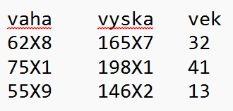
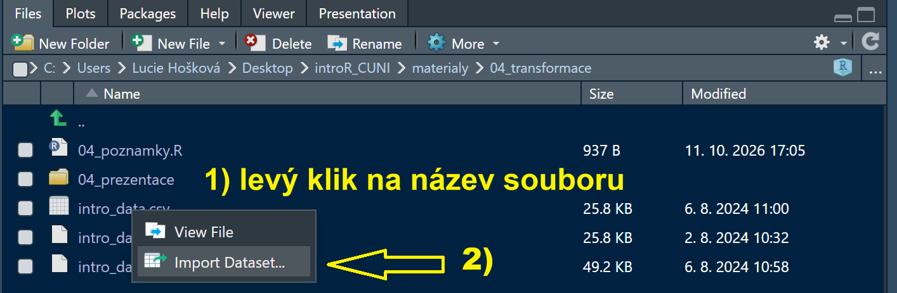
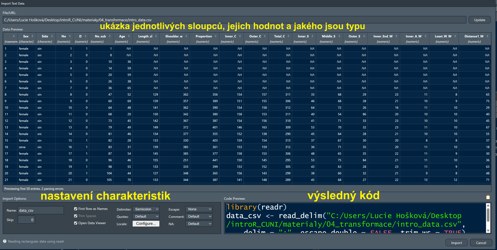
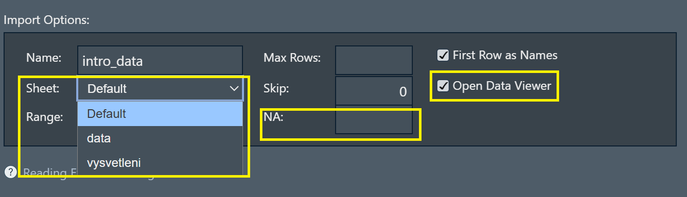
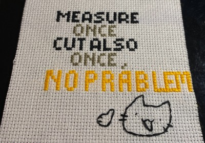
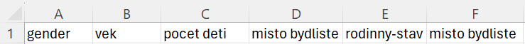
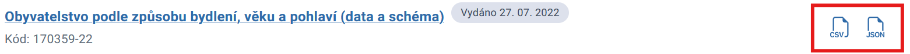

## Program

::: incremental
- opakování z minulé hodiny
- kontrola domácího úkolu
- pipes
- nahrávání dat
- transformace dat
  - úprava jmen sloupců
  - chybějící hodnoty
  - mutace a řazení podle jednotlivých hodnot
  - vytváření sloupců
:::

------------------------------------------------------------------------

## Kontrola domácí práce

```{r}
#| context: setup
#| echo: false
library(tidyverse)
```

### Úloha 1

Vyber z následujícího vektoru každou pátou hodnotu.

::: fragment
1.  Pojmenujte si vektor pro snažší manipulaci.

    ```{r}
    hodnoty <- seq(15.2, 45.7, 0.56); hodnoty
    ```
:::

::: fragment
2.  Vytvořte sekvenci, která v sobě bude obsahovat čísla v intervalu pěti od 0 do posledního čísla vektoru = každé páté číslo.

    ```{r}
    seq(0, length(hodnoty), by = 5)
    ```
:::

::: fragment
3.  Použijte výslednou sekvenci čísel k indexaci.

    ```{r}
    hodnoty[seq(0, length(hodnoty), by = 5)]
    ```
:::

------------------------------------------------------------------------

### Úloha 2

Z datasetu (co je nahraný v R) jménem `airquality`, který obsahuje informace o měření kvality vzduchu v NYC, vyber hodnoty ze sloupce `Temp` z prvního týdne v květnu.

::: fragment
1.  Zobrazme si prvních několik řádků a podívejme se na strukturu.

    ```{r}
    str(airquality)
    head(airquality)
    ```
:::

::: fragment
2.  Vyfiltrujeme hodnoty, které byly naměřeny první týden v květnu.

    ```{r}
    #vyber z hodnot sloupce
    airquality$Temp[airquality$Month == 5 & airquality$Day %in% 1:7]
    airquality$Temp[airquality$Month == 5 & airquality$Day <= 7]

    #vyber z datasetu
    airquality[airquality$Month == 5 & airquality$Day %in% 1:7, "Temp"]
    ```
:::

::: fragment
3.  Lze použít i funkci `filter`, zde už je ale třeba přemýšlet o tom, jestli nám na takto malém kusu kódu opravdu ušetří práci.

    ```{r}
    library(dplyr)
    datumy <- filter(airquality, 
       Day %in% 1:7,
       Month == 5)
    unlist(select(datumy, Temp))
    ```
:::

------------------------------------------------------------------------

### Úloha 3

K datasetu `airquality` přidejte nový sloupec s názvem `Weather` který bude obsahovat informaci (text `hot`), zda hodnoty ve sloupci `Temp` jsou vyšší než 70. Pokud není vyšší jako 70, bude obsahovat text `cold`.

::: fragment
1.  Pomocí symbolu `$` vytvoříme nový sloupec `Weather`, a přiřadíme do něj hodnotu cold.

    ```{r}
    airquality$Weather <- "cold"
    airquality
    ```
:::

::: fragment
2.  Totéž provedeme s hodnotou `hot`, pro kterou platí podmínka `Temp > 70`.

    ```{r}
    airquality$Weather[airquality$Temp > 70] <- "hot"
    airquality
    ```
:::

------------------------------------------------------------------------

## Bonus

Pokuste se zjistit, jak si v nápovědě můžete najít seznam nahraných datasetů v R (`iris`, `cars`, `dplyr::starwars` a jiné)

::: fragment
Pro vyhledání můžete použít následující funkci:

```{r}
data()
```

Díky této funkci si můžeme rychle zjisti, jaké datasety máme k dispozici v nahraných balíčcích, a **které je proto možné rovnou použít bez jejich opakovaného ukládání do globálního prostředí.**
:::

------------------------------------------------------------------------

Jak jsme si ukázali v předchozí lekci, **v R se často kód "vrství"; výsledek jedné funkce se používá jako data pro další výpočet v jiné funkci**.

To lze provést bud´ tak, že se celý výpočet rovnou použije v následující funkci, či se uloží jako proměnná, která se následně použije.

**Ukázka:**

```{r}
#1
head(select(filter(iris, Species == "setosa"), Petal.Width))

#2
filtrIris <- filter(iris, Species == "setosa")
vyberFiltrIris <- select(filtrIris, Petal.Width)
head(vyberFiltrIris)
```

------------------------------------------------------------------------

1.  První přístup v sobě nese riziko, že takto psané "funkce ve funkci ve funkci..." **řetězce budou nepřehledné a že uživatel snadno zapomene na jednu ze závorek**.

2.  Konstatním ukládáním v druhém případě se nejenom zbytečně zabírá čas a paměť R, ale hlavně pokud dojde ke změně v uložených hodnotách (například, že hledáme `Petal.Length` místo `Petal.Width`), tak **bez opakovaného nahrání následujících řádků kódu co definují následně uložené proměnné by se změny nepropsaly do zbytku kódu**.

Jak tento problém vyřešit?

------------------------------------------------------------------------

{fig-align="center"}

------------------------------------------------------------------------

## Pipes

**Nástroj, který transportuje data z jedné funkce do druhé jako první argument.**

```{r}
filter(iris, Petal.Width > 2) %>%
  select(Petal.Length, Petal.Width) %>%
  head()
```

**`data %>% funkce(`**`data přivedená skrz pipe, nemusíme je vypisovat,` **`druhý a další argumenty = definované námi)`**

```{r}
head(cars)
cars %>% head()
```

------------------------------------------------------------------------

Co když chci využít **data v jiném než v prvním argumentu**?

```{r}
iris %>%
  filter(Petal.Length > 0.8, Petal.Width < 1) %>%
  select(Sepal.Length) %>%
  unlist() %>% #preved na vektor
  mean() %>%
  round(digits = 3, x = .) #ukazka, bezne je x prvni argument
```

::: callout-important
## Specifikování argumentu kam má pipe vyústit

Tečka u pipe `%>%` z**načí místo, kam se mají data vložit**; v některých případech totiž první argument nebývají samotná data.
:::

A co **běžná indexace**? Jak určíme že se mají data vybírat, když se nejedná o argumenty?

```{r}
#tecka znaci misto vyusteni pipe
cars %>% .[,2] 
cars %>% .$speed
cars %>% .["speed"]
cars %>% .[["dist"]]
```

------------------------------------------------------------------------

### Rozdíl mezi `%>%` a `|>`

`%>%`

- déle používaná, větší šance že na ni narazíte
- pro její používání je potřeba mít načtený balíček `dplyr`
- jako placeholder umístění dat používá tečku .
- funguje s i bez závorkami za názvem funkce

```{r}
c(1:20, 15) %>% mean()
c(9:100, 1:15) %>% mean
```

`|>`

- od roku 2021 součástí baseR
- není potřeba mít spuštěný balíček navíc
- jako placeholder umístění dat používá podtržítko \_
- vždy je potřeba za název funkce umístit kulaté závorky

```{r}
c(2:546, 467, 87) %>% mean()
```

------------------------------------------------------------------------

## Procvičení

Zjistěte, jaká byla nejmenší váha kuřete krmeného sójovými boby, jejichž data naleznete v datasetu `chickwts`.

```{webr-r}

```

Jaká byla největší hloubka epicentra zemětřesení z datasetu `quakes`, které bylo větší než medián magnitudy všech naměřených zemětřesení?

```{webr-r}

```

------------------------------------------------------------------------

### Pipes a dobrá praxe

::: incremental
- používejte v jednom scriptu pokud možno jeden typ pipe

- pipe má smysl od tří a výše funkcí

- pokud používáte `%>%` dejte si pozor na záměnu tečky a čárky

- jakmile máte deset a více pipes, tak už by bylo přeci jen dobré si to rozdělit

- pipes jsou lineární; pokud pracujete s více jak jedním výstupem, buď to budete mít krkolomné nebo vám kód vůbec nebude fungovat
:::

------------------------------------------------------------------------

# Nahrávání dat

Nahrávání dat je jedna z klíčových znalostí, které je potřeba při práci v R znát.

Stejně jako u indexace, tak i zde existují jak základní příkazy v `baseR`, tak i funkce ve secializovaných balíčcích (k tomu ale později).

::: callout-warning
## Nastavení working directory

Před nahráváním dat se ujistěte, že máte nastavenou cestu do adresáře, ze kterého R může čerpat soubory.

**Pokud máte vytvořený R projekt, který se nachází ve stejné složce jako soubory, tato starost vám odpadá.**
:::

------------------------------------------------------------------------

## funkce `read.table`

**Základní funkce k načítání tabulkových dat do R.**

Má v sobě několik podtypů pro specifické formáty:

- `read.table` = hodnoty oddělené mezerou
- `read.csv` = hodnoty oddělené čárkou
- `read.delim` = hodnoty oddělené tabulátorem

**Co to znamená, že jsou hodnoty oddělené?**

------------------------------------------------------------------------

### Jak má R se souborem pracovat?

Všechny funkce, které nahrávají data do R, v sobě obsahují argumenty, pomocí kterých určujeme, jakým způsobem mají být data načtena.

- `file`: jaký je název souboru? (`"nazev.zkratkaFormatu"`)
- `header`: je první řádek hlavička? (`TRUE / FALSE`)
- `sep`: co odděluje jednotlivé hodnoty? (`" "` `","` `"\t"` `";"`...)
- `dec`: jak určujeme desetinou hodnotu? (`"."` `","` `";"`...)
- a mnoho jiných...

Když můžeme určit separátor, proč existují specifické funkce?

------------------------------------------------------------------------

Nahrání zkušebního souboru s určením argumentů:

```{r}
dataTxt <- read.delim(file = "intro_data.txt",
                       header = TRUE,
                       sep = "", #co je separator
                       dec = ".", #co je desetinna carka
                       na.strings = "NA") #co jsou chybejici hodnoty
```

Nahrání zkušebního souboru bez určení argumentů:

```{r}
dataTxt2 <- read.delim(file = "intro_data.txt")
```

Jsou tyto dva soubory identické?

```{r}
identical(dataTxt, dataTxt2)
```

::: callout-important
## Nezapomeňte na defaultní nastavení arguentů funkce!

Spousta funkcí má u argumentů nastavené nějaké defaultní (nejčastěji používané) hodnoty.

Je proto zbytečné argumenty vypisovat znovu, pokud se nijak neliší od defaultního nastavení.
:::

Řešení otázky "proč existují specifické funkce?"

**Protože jsme lenoši.**

------------------------------------------------------------------------

### argument `file`

- vždy musí být v uvozovkách a obsahovat přesný název souboru, včetně jeho formátové koncovky

- je potřeba, aby obsahoval **přesný popis cesty** k tomuto souboru

  - Co když máme v projektu dedikovanou **podsložku** na data?

```{r}
dataUvnitrPodslozkyvProjektu <- read.delim("data/skrytadata.txt")
```

- Co když si potřebujeme vytáhnout **soubor mimo projekt**, a nebo nemáme projekt ani nastavený working directory?

```{r}
dataBezUrcenehoWD <- read.delim("C:/Users/Lucie Hošková/Desktop/introR_CUNI/materialy/04_transformace/04_prezentace/data/skrytadata.txt")
```

::: callout-note
## Absolutní a relativní cesta

Nepamatujete si, jak přesně se používají relativní / absolutní cesty a projekty? Podívejte se znovu do první lekce, sekce [Working depository](https://luc-hoskova.github.io/introR_CUNI/materialy/01_uvod/01_prezentace/01_prezentace.html#/working-directory) a [RProjekty](https://luc-hoskova.github.io/introR_CUNI/materialy/01_uvod/01_prezentace/01_prezentace.html#/rprojekty).
:::

------------------------------------------------------------------------

### argument `sep`

Separátor je symbol či série symbolů, které **určují ohraničení jednotlivých sloupců**.

Jaké máme různé druhy separátorů?

- `""`: white space, aka mezera/mezery
- `""`: coma, čárka - CSV je Coma Separated Values
- `"\t"`: tabulátor
- `";"`: semicolon, středník

Toto jsou nejčastější typy separátorů, **můžete se ovšem setkat i s jinými individualizovanými separátory**.

Detailněji si tato individualizovaná nastavení ukážeme v následující sekci.

------------------------------------------------------------------------

### argument `dec`

Pomocí tohoto argumentu si definujeme symboly, které **určují desetinou čárku**.

Je možné používat jako desetinnou čárku libovolný symbol?

{fig-align="center"}

```{r}
decZkouska <- read.delim("decZkouska.txt", dec = "X")
head(decZkouska)
```

------------------------------------------------------------------------

## Balíček `readr`

- je součástí metabalíčku `tidyverse`

- umožňuje načtení souboru klikáním v RStudiu **bez psaní kódu**

  - pozor, nefunguje na `.txt` data!

**Postup:**

Vyzkoušíme si to na datech `intro_data.csv`.

{fig-align="center"}

{fig-align="center"}

------------------------------------------------------------------------

### Dobrá praxe práce s balíčky, které umožňují importování

**Vždy si kód zkopírujte do skriptu a manuálně ho projeďte.**

- import provedete spuštění kódu na pozadí a ve skriptu po něm nezůstane ani stopa, při příštím spuštění samotného skriptu by vám tak nedošlo k načtení dat

**Nezapomeňte si spustit jednotlivé balíčky pomocí fce `library`.**

- není třeba nahrávat celý `tidyverse`, stačí jednoduchý název specifického balíčku

------------------------------------------------------------------------

## Balíček `readxl` - ach ty Excely...

- je součástí metabalíčku `tidyverse`

{fig-align="center"}

------------------------------------------------------------------------

Postup je při nahrávání velmi podobný balíčku `readr`, má ovšem **pár důležitých detailů**.

Vyzkoušíme si to na datech `intro_data.xlsx`.



- `Sheet`: z jakého listu chceme vybírat?

- `NA`: narozdíl od `baseR` a `readr` tento balíček neumí automaticky rozpoznávat NA hodnoty

- `Open Data Viewer`: v RStudiu automaticky otevře náhled

------------------------------------------------------------------------

## Samostatné cvičení

```{r}
#| echo: false
countdown::countdown(minutes = 10,
                     seconds = 0,
                     start_immediately = FALSE,
                     warn_when = 120,
                     top = "0")
```

Načtěte si soubor `samostatneCviceniData.txt` a uložte si ho jako `data`. Přeměňte si sloupec `vzdelani` na faktory[^1] a vypočítejte průměrnou výšku ze sloupce `vyska`.

[^1]: Podívejte se do nápovědy; neexistuje na to přímo argument?

------------------------------------------------------------------------

### Řešení

Načtěte si soubor `samostatneCviceniData.txt` a uložte si ho jako `data`. Přeměňte si sloupec `vzdelani` na faktory a vypočítejte průměrnou výšku ze sloupce `vyska`.

::: fragment
1.  Načteme si soubor pomocí funkce `read.delim` a podíváme se na strukturu.

    ```{r}
    data <- read.delim("samostatneCviceniData.txt")
    str(data)
    ```
:::

::: fragment
2.  Je vidět, že soubor má jiný typ separátoru, než jsme očekávali. Musíme podle toho proto upravit argumenty funkce.

    ```{r}
    data <- read.delim("samostatneCviceniData.txt",
                       dec = ",")
    str(data)
    ```

    Nebo můžeme použít funkci, která má přímo určenu desetinnou čárku.

    ```{r}
    data2 <- read.delim2("samostatneCviceniData.txt")
    str(data2)
    ```
:::

::: fragment
3.  Změňme charakterové stringy (sloupec `vzdelani`) na faktory.

    ```{r}
    data <- read.delim("samostatneCviceniData.txt",
                       dec = ",",
                       stringsAsFactors = TRUE)
    str(data)
    ```
:::

::: fragment
4.  Spočítejme si průměrnou výšku.

    ```{r}
    mean(data$vyska) #175.15
    ```
:::

------------------------------------------------------------------------

# Transformace dat

Máme nahrána data, co s nimi ted´?

Před tím, než se vrhneme na jakoukoliv analýzu, tak **je třeba si data zkontrolovat a dle potřeby upravit**.

{fig-align="center"}

------------------------------------------------------------------------

## Podivné názvy sloupců

Někdy se může stát, že máte v R dataset, u které jsou jsou **sloupce s totožnými názvy následované čísly a s tečkami mezi slovy**, i když v původním souboru nic takového není.

{fig-align="center"}

```{r}
df <- read.delim("bydliste.txt")
head(df)
str(df)
```

Co se to děje?

------------------------------------------------------------------------

R automaticky kontroluje, zda **jsou všechny názvy sloupců "validní"**. Provádí se to pomocí defaultního argumentu fce `read.table` a to `check.names = TRUE`.

To znamená, že nemají mezery a **slova jsou oddělena stejným symbolem**, a v **případě duplikátů jmen sloupců** je k nim přiřazen symbol, který je odliší.

Co když se nám ale dané jméno nelíbí? Jak si ho přejmenovat?

```{r}
df <- df %>%
  dplyr::rename(adresa = misto.bydliste.1)
head(df)
```

::: callout-tip
## Přejmenování bez potřeby znát pozici sloupce

Sice už umíme používat fce `dimnames`, `colnames` a jejich příslušné varianty v argumentech funkcí, i tak se ale hodí znát funkci, která nám **změní specifický sloupec bez toho, abychom museli hledat jeho pořadí** či nějak složitě vypisovat veškerá jména sloupců.
:::

------------------------------------------------------------------------

## Chybějící hodnoty

Při kontrole dat jsme si mohli všimnout, že v souboru jsou podivně zapsané chybějící hodnoty - jak prázdná místa, tak text `N/A`.

**Jak toto vše můžeme převést na jednoduchá `NA`?**

```{r}
dfNA <- read.delim2("bydliste.txt",
                    na.strings = c("", "N/A")) #"" urcuje mezeru/prazdne pole
dfNA
```

**Nejlepším místem je již určení si hodnot při samotném načítání dat argumentem `na.strings`.** Někdy se ale může stát, že si toho všimnete pozdě, a už jste na datasetu provedli rozličné změny.

Jak si tedy můžete tyto hodnoty změnit zpětně?

------------------------------------------------------------------------

## Samostatné cvičení

```{r}
#| echo: false
countdown::countdown(minutes = 5,
                     seconds = 0,
                     start_immediately = FALSE,
                     warn_when = 60,
                     top = "0")
```

Upravte hodnoty uvnitř data frame `df` tak, aby místo prázdných buněk a charakterové hodnoty `N/A` byly přímo hodnoty `NA`.

::: callout-tip
## Nezapomeňte na to, co jsme se již naučili

Na předchozí lekci jsme si ukázali, jakým způsobem lze vybrat z celého data frame specifické hodnoty. Jak bychom to mohli aplikovat zde?

**Přemýšlejte o tom jednoduše - není třeba žádných složitých indexací.**
:::

------------------------------------------------------------------------

## Řešení

Upravte hodnoty uvnitř data frame `df` tak, aby místo prázdných buněk a charakterové hodnoty `N/A` byly přímo hodnoty `NA`.

::: incremental
1.  Pomocí základní indexace si vybereme všechny hodnoty z `df`, pro které platí `df == "N/A" | df == ""`.

    ```{r}
    df == "N/A" | df == ""
    ```

2.  Tyto hodnoty si přepíšeme na `NA`

    ```{r}
    df[df == "N/A" | df == ""] <- NA;
    df
    ```
:::

------------------------------------------------------------------------

### Odstranění `NA` hodnot

Dejme ale, že bychom v datasetu chtěli mít pouze kompletní řádky, tzn. chceme se zbavit řádků obsahující `NA` hodnoty. Jak na to?

```{r}
dim(df)
df <- na.omit(df)
dim(df)
df
```

------------------------------------------------------------------------

Co se stalo? Zmizely všechny řádky, co měli v jakémkoliv sloupci `NA`. O jaké řádky se ale jednalo?

```{r}
which(!complete.cases(dfNA))
```

**Dokážete vysvětlit, co se v tomto kombinací těchto funkcí a jejich aplikaci na dataset stane?**

Co dělá funkce `complete.cases` a proč ji zde používáme?

::: incremental
1.  **Jako první se podíváme do nápovědy** a zjistíme si, co znamená funkce `complete.cases`.

2.  Ta vytvoří vektor, který v sobě bude obsahovat **informace, zda jednotlivé řádky jsou kompletní** - neobsahují žádné chybějící hodnoty.

3.  My ovšem chceme vědět, které řádky chybějící hodnoty obsahují - **provedeme proto negaci pomocí symbolu `!`**.

4.  A funkce `which` nám pak už pouze řekne, na jaké pozici ve vektoru těchto hodnot se výsledné `TRUE` (řádek obsahuje `NA` hodnoty) nachází.
:::

------------------------------------------------------------------------

Máme nyní přejmenované sloupce, odebrané `NA` hodnoty... Znamená to, že s ním nyní můžeme provádět výpočty, či na něj aplikovat jakékoliv další akce?

::: fragment
```{r}
str(df)
```

Jak vidíme, **kvůli špatně zapsaným `NA` hodnotám se nám většina sloupců překonvertovala do charakterového typu**.

Když se ale na data frame podíváme, tak je jasné, že některé sloupce můžeme změnit na faktory a jiné budou jasně numeric.

```{r}
df
```
:::

------------------------------------------------------------------------

## Funkce `mutate` aneb úprava a vytváření sloupců

Pomocí funkce `mutate` můžeme upravovat specifické sloupce bez dlouhého přiřazování.

Při jejím používání defacto potřebujeme pouze následující zápis:

`mutate(název dataframe, název sloupce = nová podoba sloupce)`

```{r}
df <- df %>% mutate(
  gender = as.factor(gender),
  vek = as.numeric(vek),
  pocet.deti = as.numeric(pocet.deti),
  rodinny.stav = as.factor(rodinny.stav)
)
```

Jaký je nyní výsledek?

```{r}
str(df)
```

------------------------------------------------------------------------

## Přidávání sloupců

Tímto způsobem si ale můžeme sloupce nejenom upravovat, ale i přidávat.

```{r}
df <- df %>% mutate(
  telefonni.cislo = NA,
  id = paste0("id_", 1:nrow(df)))
head(df)
```

------------------------------------------------------------------------

## Samostatné cvičení

```{r}
#| echo: false
countdown::countdown(minutes = 20,
                     seconds = 0,
                     start_immediately = FALSE,
                     warn_when = 120,
                     top = "0")
```

Proved na souboru `census.csv` následující změny:

1.  Přejmenuj sloupce `pohlavi_txt` na `pohlavi`, `vek_txt` na `vek`, `vira_txt` na `vira`, a `uzemi_txt` na `oblast`.

2.  Vyber pouze hodnoty pohlaví `žena`, ty kde `vira` je `Jedi`, `Sith` a nebo začíná na `pasta`[^2] a nakonec pak pouze ty osoby, které mají věk v rozpětí 0-18 a 65+[^3].

3.  Vyber pouze hodnoty pro celý stát, tedy ty, které mají ve sloupci `oblast` hodnotu `Česká republika`.

4.  Vyber sloupce `vek`, `pohlavi`, `vira` a `hodnota`.

5.  Kolik je nejstarší české Jedi? Zjisti funkcí.

6.  Spočítej pro každý kraj průměrný věk pro všechna náboženství.

[^2]: Něco podobného jsme prováděli u funkce `select`. Existuje nějaká funkce z `base`, která lze použít?

[^3]: Jako vždy, StackOverflow a podobná uživatelská fóra jsou vašim nejlepším přítelem. Malá nápověda: k manipulaci sloupce `vek` můžete použít například jednu jednoduchou funkci z balíčku `readr`. Pokud nebudete vůbec vědět jak dál, řekněte si o nápovědu ;\].

------------------------------------------------------------------------

## Řešení

::: incremental
1.  Načti data a zkontroluj je.

    ```{r}
    census <- read.csv("census.csv")
    str(census)
    ```

2.  Přejmenuj sloupce

    ```{r}
    census <- census %>%
      rename(
        vira = vira_txt,
        pohlavi = pohlavi_txt,
        vek = vek_txt,
        oblast = uzemi_txt)
    ```

3.  Přetvoř sloupec `vek` tak, aby obsahoval pouze čísla.

    ```{r}
    census <- census %>%
      mutate(vek = readr::parse_number(vek))
    ```

4.  Vyfiltruj řádky splňující dané podmínky.

    ```{r}
    census <- census %>%
      filter(
    vira %in% c("Jedi", "Sith") | startsWith(vira, "pasta"),
    pohlavi == "žena",
    vek %in% 0:18 | vek >= 65,
    oblast == "Česká republika")
    ```

5.  Vyber relevatní sloupce.

    ```{r}
    census <- census %>%
      select(hodnota, pohlavi, vek, vira)
    ```

6.  Zjisti věk nejstarší Jedi v ČR.

    ```{r}
    jedi <- census %>% filter(vira == "Jedi",
                              hodnota > 0)
    max(jedi$vek)
    ```

7.  Spočítej pro každý kraj průměrný věk pro všechna náboženství ve výsledném datasetu.

    ```{r}
    levels(as.factor(census$vira))

    jedi <- census %>% filter(vira == "Jedi", hodnota > 0)
    sith <- census %>% filter(vira == "Sith", hodnota > 0)
    pasta <- census %>% filter(vira == "pastafariánství", hodnota > 0)

    mean(jedi$vek)
    mean(sith$vek)
    mean(pasta$vek)
    ```
:::

------------------------------------------------------------------------

A nešlo by to nějak... jednodušeji?

::: fragment
Samozřejmě :\]
:::

::: fragment
Vytvoření datasetu na kterém budeme vytvářet výpočty si jde napsat pomocí dlouhé pipe.

```{r}
census2 <- read.csv("census.csv")
str(census2)

census2 <- census2 %>%
  rename(
    vira = vira_txt,
    pohlavi = pohlavi_txt,
    vek = vek_txt,
    oblast = uzemi_txt) %>%
  mutate(vek = readr::parse_number(vek)) %>%
  filter(
    vira %in% c("Jedi", "Sith") | startsWith(vira, "pasta"),
    pohlavi == "žena",
    vek %in% 0:18 | vek >= 65,
    oblast == "Česká republika",
    hodnota > 0) %>%
  select(hodnota, pohlavi, vek, vira)
```
:::

::: fragment
Poté už jen provedeme výpočet jednotlivých hodnot.

```{r}
census2 %>% group_by(vira) %>%
  summarize(nejstarsiVerici = max(vek), prumernyVek = mean(vek))
```

S funkcemi `group_by` a `summarize` se lépe seznámíme v šesté sekci, zde jsou uvedeny jako ukázka zjednodušení postupu.
:::

------------------------------------------------------------------------

## Domácí úkol

1.  Najděte specifickou funkci v balíčku `dplyr`, která umožňuji přepisování hodnot na `NA`.

2.  Načti si dataset [`typBydleni.csv`](https://luc-hoskova.github.io/introR_CUNI/materialy/04_transformace/04_prezentace/typBydleni.csv). Zjisti z něj následující údaje:

    1.  Kolik osob ve věku 18-26 včetně v Jihomoravském kraji jsou evidováni jako osoby bez domova, a jakou procentuální část z nich tvoří muži a jakou ženy.

    2.  Který kraj má nejmenší počet obyvatel žijících v ubytovacích zařízení?

    3.  Jaký je medián věku osoby bez domova v Praze, a jaký je v celé ČR?

    4.  Jaký je nejčastější typ ubytování osob pod 18 let v ČR?

    5.  O kolik více seniorů (65+ let) bez domova žije v Libereckém než v Moravskoslezském kraji či naopak?

Zdrojem dat jsou [oficiální stránky sčítání obyvatel z roku 2021](https://csu.gov.cz/produkty/vysledky-scitani-2021-otevrena-data). K této tabulce patří i JSON soubor, který popisuje význam jednotlivých sloupců. Můžete ho využít pro lepší pochopení datasetu, ale ke zpracování domácího úkolu nemusíte vyhledávat žádné další informace.

{fig-align="center"}

Skript s výpočtem zašlete nejpozději do pátku před příští hodinou na [lucie.hoskova\@ruk.cuni.cz](mailto:lucie.hoskova@ruk.cuni.cz)

------------------------------------------------------------------------

## Tipy navíc pro samostudium

### Změna pořadí sloupců

Co kdybychom chtěli mít sloupce na jiné pozici, než jsou v nahraném datasetu?

Použijeme k tomu funkci `dplyr::relocate`.

```{r}
dfTipy <- read.delim("intro_data.txt")
dfTipy <- dfTipy[,1:7] #ukazkovy dataset

dfTipy <- dfTipy %>% relocate(No:No_sub, .before = Sex)
dfTipy <- dfTipy %>% relocate(Sex, .after = Age)
dfTipy <- dfTipy %>% relocate(Side, .after = last_col())
```

------------------------------------------------------------------------

### Seřazení řádků dle hodnot ve sloupcích

Může se stát, že si budete potřebovat srovnat podle hodnot v nějakém sloupci. Jak to provedete?

```{r}
dfTipy %>% arrange(Age) #vzestupne
dfTipy %>% arrange(desc(Age)) #sestupne
```

**Co když ale máme ve sloupci více stejných hodnot?** Můžeme si určit další sloupec, dle kterého by se mělo filtrovat?

Přidáváním dalších a dalších sloupců, dle kterých se může srovnávat, si můžeme vytvořit opravdu podrobně seřazený data frame.

```{r}
dfTipy %>% arrange(Age, Length_cl)
```

------------------------------------------------------------------------

### Načítání velkých souborů

**V balíčku `readr` se nachází taktéž funkce `read_csv`.**

Tu se hodí používat, pokud nahráváte objemnější datasety; běží 2-3x rychleji než `read.csv` v základním R.

------------------------------------------------------------------------

### Varianta indexování s pipe

Jedním z míst, kde můžete narazit na potenciální problémy s používání pipe, je indexace.

V sekci [Specifikování argumentu kam má pipe vyústit] jsme si sice již ukázali, že pomocí placeholderu si **můžeme určit místo vyústění pipe i mimo první argument funkce,** ale nejedná se o úplně nepřehlednější řešení.

```{r}
iris %>%
  .$Sepal.Width %>%
  head()
```

Je možné proto **využít funkce `pull`**.

```{r}
iris %>%
  pull(Sepal.Width) %>%
  head()
```

------------------------------------------------------------------------

### Vyhledávání pomocí specifického textu

Dejme tomu, že pracujete s datasetem ke kterému nemáte mnoho informací, a **chcete zjistit, zda se v něm nachází hodnota obsahující určitý text.**

Přesně k tomuto je určena funkce `grepl`.

Dejme tomu, že chceme zjisti, kolik bouří v datasetu `storms` má jméno obsahující text `"MAR"`.

```{r}
storms$name[grepl("MAR", toupper(storms$name))] %>% unique()
```

Funkce `grepl` zjistí, zda se uvedený text (MAR) nachází v objektu hodnot (hodnoty sloupce `name`).

**Jelikož R je case sensitive, doporučuji vždy vyhledávat pomocí velkých písmen, a převést si na ně i hodnoty, ze kterých se vyhledává.** Pojďme se podívat na to, co by se stalo, kdybychom tak neprovedli.

```{r}
storms$name[grepl("mar", storms$name)] %>% unique()
```

Funkce by nám nenašla žádnou z jiných bouří, které tyto písmena obsahují, protože se jedná o jména obsahující písmena "m" "a" "r" v jejich upper case podobě.

```{r}
#TRUE/FALSE zda hodnota obsahuje "MAR"
grepl("MAR", toupper(storms$name))
#vyber hodnoty z name pro ktere je podminka TRUE
storms$name[grepl("MAR", toupper(storms$name))] 
storms$name[grepl("MAR", toupper(storms$name))] %>%
  unique() #kazde jmeno jen jednou
```
