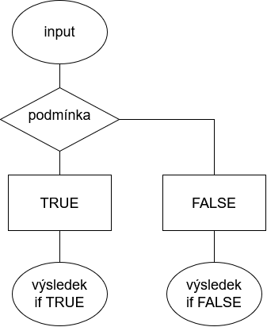
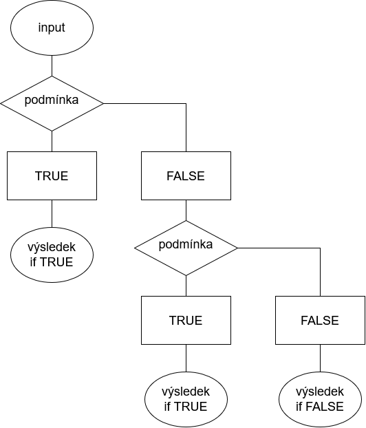
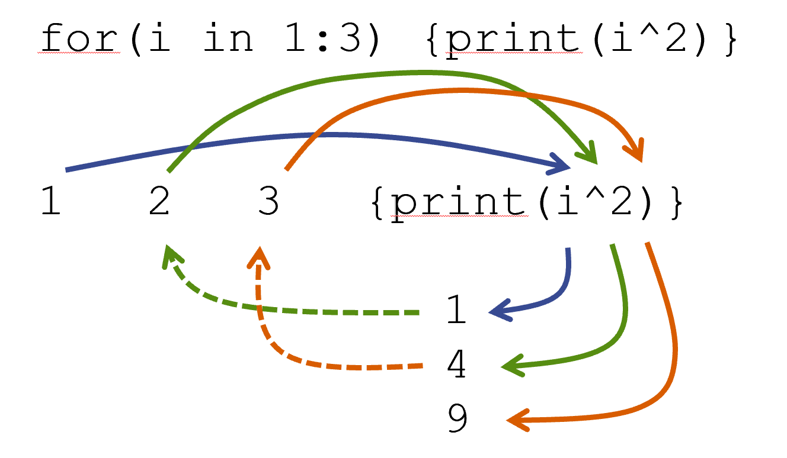

## Program

::: incremental
- opakování z minulé hodiny
- kontrola domácího úkolu
- co je to programování v R?
- `if ... else`
- funkce `ifelse`
- cykly
- rodina `apply` funkcí
  - úprava jmen sloupců
  - chybějící hodnoty
  - mutace a řazení podle jednotlivých hodnot
  - vytváření sloupců
- tvorba vlastní funkce
:::

------------------------------------------------------------------------

## Kontrola domácí práce

```{r}
#| context: setup
#| echo: false
library(tidyverse)
```

### Úloha 1

**Najděte specifickou funkci v balíčku dplyr, která umožňuji přepisování hodnot na `NA`.**

::: fragment
Funkce `na_if`.

Pomocí této funkce je možné porovnat dvě hodnoty; pokud jsou totožné, první z nich bude změněna na NA.

```{r}
x <- c(1, 3, 4, 5, 4, 8, 8)
y <- c(4)
dplyr::na_if(x, y)
```
:::

------------------------------------------------------------------------

### Úloha 2

**Načti si dataset [`typBydleni.csv`](https://luc-hoskova.github.io/introR_CUNI/materialy/04_transformace/04_prezentace/typBydleni.csv).**

```         
1.  Kolik osob ve věku 18-26 včetně v Jihomoravském kraji jsou evidováni jako osoby bez domova, a jakou procentuální část z nich tvoří muži a jakou ženy.

2.  Který kraj má nejmenší počet obyvatel žijících v ubytovacích zařízení?

3.  Jaký je medián věku osoby bez domova v Praze, a jaký je v celé ČR?

4.  Jaký je nejčastější typ ubytování osob pod 18 let v ČR?

5.  O kolik více seniorů (65+ let) bez domova žije v Libereckém než v Moravskoslezském kraji či naopak?
```

::: fragment
Načteme a projdeme si dataset.

```{r}
library(tidyverse)
typBydleni <- read.csv("typBydleni.csv",
                       stringsAsFactors = TRUE)
str(typBydleni)

levels(typBydleni$bydleni_txt)
#pozor, vidime ze s Prahou to nebude tak jednoduche
  #budeme si muset zjisit hodnoty podle ciselniku
levels(typBydleni$uzemi_txt) 
levels(typBydleni$pohlavi_txt) #co je zac ""
```
:::

::: fragment
Podívejme se blíže na sloupec pohlaví, jelikož s ním budeme pracovat. **Co jsou zač řádky s prázdnými hodnotami?**

```{r}
kontrola <- typBydleni %>%
  select(hodnota, pohlavi_txt, vek_txt) %>%
  head(); kontrola

identical(kontrola[1, "hodnota"],
          sum(kontrola[2:3, "hodnota"]))

identical(kontrola[4, "hodnota"],
          sum(kontrola[5:6, "hodnota"]))
```

**Tyto řádky očividně obsahují celkové hodnoty pro obě pohlaví** - to se nám bude hodit!
:::

::: fragment
Pořád vám ale říkám, že bychom si to **neměli kontrolovat jen po oku**. Tak si na to rovnou napíšeme funkci ;\].

```{r}
kontrola_pohlavi <- function(data) {
  vysledek <- data.frame(
    radek = integer(),
    hodnota_celkem = numeric(),
    soucet_pohlavi = numeric(),
    shoda = logical()
  )
  
  for (i in 1:(nrow(data) - 2)) {
    if (data$pohlavi_txt[i] == "") {
      soucet <- sum(data$hodnota[(i + 1):(i + 2)])
      vysledek <- rbind(vysledek, data.frame(
        radek = i,
        hodnota_celkem = data$hodnota[i],
        soucet_pohlavi = soucet,
        shoda = data$hodnota[i] == soucet
      ))
    }
  }
  return(vysledek)
}

kontrola_pohlavi(typBydleni) 

kontrola_pohlavi(typBydleni) %>%
  filter(shoda == FALSE)
```
:::

::: fragment
Upravme si dataframe tak, abychom s ním mohli pracovat.

```{r}
#dataset se vsemi moznostmi pohlavi
dataBydleni <- typBydleni %>%
  rename(pohlavi = pohlavi_txt,
         uzemi = uzemi_txt,
         vek = vek_txt,
         bydleni = bydleni_txt) %>%
  mutate(vek = parse_number(as.character(vek))) %>%
  select(hodnota, pohlavi, uzemi, bydleni, vek, uzemi_cis)

#dataset jenom pro vsechny
data <- dataBydleni %>%
  filter(pohlavi == "")
```
:::

------------------------------------------------------------------------

### 2.1

**Kolik osob ve věku 18-26 včetně v Jihomoravském kraji jsou evidováni jako osoby bez domova, a jakou procentuální část z nich tvoří muži a jakou ženy.**

::: fragment
```{r}
data2.1 <- dataBydleni %>%
  filter(vek %in% 18:26,
         bydleni == "Bezdomovci",
         uzemi == "Jihomoravský kraj")

celkem2.1 <- sum(data2.1 %>%
              filter(pohlavi == "") %>%
              pull(hodnota)) #46 jedincu

muzi2.1 <- sum(data2.1 %>%
              filter(pohlavi == "muž") %>%
              pull(hodnota)); muzi2.1 #30

zeny2.1 <- sum(data2.1 %>%
              filter(pohlavi == "žena") %>%
              pull(hodnota)); zeny2.1 #16

round(muzi2.1 / celkem2.1 * 100, 2) #65.22 %
round(zeny2.1 / celkem2.1 * 100, 2) #34.78 %
```
:::

------------------------------------------------------------------------

### 2.2

**Který kraj má nejmenší počet obyvatel žijících v ubytovacích zařízení?**

::: fragment
Nejdříve si potřebujeme vybrat všechny hodnoty z `uzemi`, které jsou kraj. Jak na to?

```{r}
data %>%
  filter(grepl("kraj", uzemi)) %>%
  distinct(uzemi)
```

Máme tady všechny kraje? Nechybí nám nějaký?
:::

::: fragment
Ve výběru nám chybí Praha, jelikož ta v názvu nemá kraj. K výběru proto použijeme jinou hodnotu - a to výběrem kódu pro kraj z číselníku.

```{r}
#jake hodnoty v ciselniku ma specificky kraj?
data %>% filter(grepl("kraj", uzemi)) %>%
  pull(uzemi_cis) %>%
  unique() #100
```

A ověření, ze kterého zjistíme i kterou Prahu máme použít:

```{r}
data %>%
  filter(uzemi_cis == 100) %>%
  distinct(uzemi)
```
:::

::: fragment
Nyní si tedy můžeme spočítat, který kraj splňuje dané podmínky.

```{r}
data %>%
  filter(uzemi_cis == 100,
         bydleni == "Osoby žijící v ubytovacím zařízení") %>%
  group_by(uzemi) %>%
  summarise(pocet = sum(hodnota)) %>%
  filter(pocet == min(pocet))
```
:::

::: fragment
Další možností zjištění kraje s nejnižší hodnotou je použití funkce `dplyr::slice_min`.

```{r}
data %>%
  filter(uzemi_cis == 100,
         bydleni == "Osoby žijící v ubytovacím zařízení") %>%
  group_by(uzemi) %>%
  summarise(pocet = sum(hodnota)) %>%
  slice_min(pocet) #fce vybere radek s nejnizsi hodnotou
```
:::

------------------------------------------------------------------------

### 2.3

**Jaký je medián věku osoby bez domova v Praze, a jaký je v celé ČR?**

::: fragment
Pro snadnější manipulaci si vytvoříme dataset pouze s Prahou a lidmi v hledaném typu ubytování.

```{r}
praha <- data %>% filter(uzemi == "Hlavní město Praha",
                         bydleni == "Bezdomovci")
```
:::

::: fragment
Pro správný výpočet mediánu musíme pracovat ne pouze s výpočtem mediánu ze sloupce `vek`, ale s vektorem, který v sobě budou mít každou hodnotu ze sloupce `vek` zopakovanou tolikrát, kolikrát je ve sloupci `hodnota`.

```{r}
median(rep(praha$vek, praha$hodnota)) #51
```
:::

::: fragment
A nyní si vypočítáme medián pro celou ČR - taktéž můžeme použít možnosti vytvoření si subsetu.

```{r}
cr <- data %>% filter(uzemi == "Česká republika",
                bydleni == "Bezdomovci")

median(rep(cr$vek, cr$hodnota)) #50
```
:::

------------------------------------------------------------------------

### 2.4

**Jaký je nejčastější typ ubytování osob pod 18 let v ČR?**

::: fragment
Zjistíme si, kolik dětí je v každém typu bydlení.

```{r}
levels(data$bydleni)

detiBez <- sum(data %>%
      filter(vek < 18,
             bydleni == "Bezdomovci",
             uzemi == "Česká republika") %>%
      pull(hodnota)); detiBez #37

detiByt <- sum(data %>%
      filter(vek < 18,
             bydleni == "Byt",
             uzemi == "Česká republika") %>%
      pull(hodnota)); detiByt #1950433

detiJine <- sum(data %>%
      filter(vek < 18,
             bydleni == "Osoby žijící v jiných obydlích",
             uzemi == "Česká republika") %>%
      pull(hodnota)); detiJine #27560

detiUbyt <- sum(data %>%
      filter(vek < 18,
             bydleni == "Osoby žijící v ubytovacím zařízení",
             uzemi == "Česká republika") %>%
      pull(hodnota)); detiUbyt #13021
```
:::

::: fragment
Vidíme, že nejvíc dětí bydlí v bytě, ale kdybychom si to chtěli opravdu potvrdit...

```{r}
deti <- c(
  Bezdomovci = detiBez,
  Byt = detiByt,
  Jine = detiJine,
  Ubytovani = detiUbyt)

deti %>%
  sort(decreasing = TRUE) %>%
  .[1] #Byt 1950433
```
:::

::: fragment
Samozřejmě to můžeme udělat jednodušeji, a to pomocí `group_by`.

```{r}
data %>%
  filter(vek < 18,
         uzemi == "Česká republika",
         bydleni != "Obyvatelstvo podle způsobu bydlení celkem (kromě bezdomovců)") %>%
  group_by(bydleni) %>%
  summarise(pocet = sum(hodnota)) %>%
  slice_max(pocet) #Byt 1950433
```
:::

------------------------------------------------------------------------

### 2.5

**O kolik více seniorů (65+ let) bez domova žije v Libereckém než v Moravskoslezském kraji či naopak?**

::: fragment
```{r}
sL <- sum(data %>%
      filter(vek > 64,
             uzemi == "Liberecký kraj",
             bydleni == "Bezdomovci") %>%
      pull(hodnota)); sL #23

sM <- sum(data %>%
      filter(vek > 64,
             uzemi == "Moravskoslezský kraj",
             bydleni == "Bezdomovci") %>%
      pull(hodnota)); sM #77

#jaky je rozdil v poctu osob bez domova meti libereckym a moravskoslezskym krajem
sM - sL
```
:::

------------------------------------------------------------------------

## Programování v R

Programování v R neznamená pouze vytváření si vlastních funkcí a balíčků, ale i **automatizaci provádění opakujících se činností**.

Dejme tomu, že máme pro každou třídu v ročníku tabulku s počtem bodů:

```{r}
pocetBoduA <- data.frame(Martin = c(20, 55, 46, NA, 30),
                        Ludmila = c(80, 95, 12, 70, 69),
                        Jana = c(NA, NA, 5, 12, 3)); pocetBoduA

pocetBoduB <- data.frame(Kvido = c(18, 65, NA, NA, NA),
                       Saša = c(NA, 55, NA, 23, 79),
                       Ondra = c(100, 98, 99, 100, 95)); pocetBoduB

pocetBoduC <- data.frame(Ivan = c(42, 67, 69, NA, NA),
                         Oto = c(68, 83, 92, 88, 79),
                         Marie = c(NA, NA, 5, 6, 2)); pocetBoduC
```

Chceme si převést počet bodů na známky podle následujícího klíče:

| počet bodů | známka          |
|------------|-----------------|
| 100 - 90   | výborný         |
| 85 - 76    | velmi dobrý     |
| 75 - 50    | dobrý           |
| \< 50      | nedostatečné    |
| NA         | neklasifikováno |

------------------------------------------------------------------------

**Co je jednodušší? Toto**

```{r}
pocetBoduA_hodnoceni <- pocetBoduA

pocetBoduA_hodnoceni[] <- "výborný"
pocetBoduA_hodnoceni[pocetBoduA < 90] <- "velmi dobrý"
pocetBoduA_hodnoceni[pocetBoduA < 75] <- "dobrý"
pocetBoduA_hodnoceni[pocetBoduA < 50] <- "nedostatečný"
pocetBoduA_hodnoceni[is.na(pocetBoduA)] <- "neklasifikováno"
pocetBoduA_hodnoceni

pocetBoduB_hodnoceni <- pocetBoduB

pocetBoduB_hodnoceni[] <- "výborný"
pocetBoduB_hodnoceni[pocetBoduB < 90] <- "velmi dobrý"
pocetBoduB_hodnoceni[pocetBoduB < 75] <- "dobrý"
pocetBoduB_hodnoceni[pocetBoduB < 50] <- "nedostatečný"
pocetBoduB_hodnoceni[is.na(pocetBoduB)] <- "neklasifikováno"
pocetBoduB_hodnoceni

pocetBoduC_hodnoceni <- pocetBoduC

pocetBoduC_hodnoceni[] <- "výborný"
pocetBoduC_hodnoceni[pocetBoduC < 90] <- "velmi dobrý"
pocetBoduC_hodnoceni[pocetBoduC < 75] <- "dobrý"
pocetBoduC_hodnoceni[pocetBoduC < 50] <- "nedostatečný"
pocetBoduC_hodnoceni[is.na(pocetBoduC)] <- "neklasifikováno"
pocetBoduC_hodnoceni
```

------------------------------------------------------------------------

**Nebo toto?**

```{r}
hodnoceni <- function(x) {
  dplyr::case_when(
    is.na(x) ~ "neklasifikováno",
    x < 50 ~ "nedostatečný",
    x < 75 ~ "dobrý",
    x < 90 ~ "velmi dobrý",
    .default = "výborný")
}

vysledekA <- pocetBoduA %>%
  mutate(across(everything(), hodnoceni)); vysledekA

vysledekB <- pocetBoduB %>%
  mutate(across(everything(), hodnoceni)); vysledekB

vysledekC <- pocetBoduC %>%
  mutate(across(everything(), hodnoceni)); vysledekC
```

------------------------------------------------------------------------

**To, co si tady budeme ukazovat je opravdu pouhý úvod a strohý výběr toho, co je dle mého názoru nepojdstatnější znát.**

Budeme se věnovat hlavně tomu, co vám může pomoci urychlit a zjednodušit si analýzu dat.

### Zdroje pro samostrudium

**WICKHAM, Hadley a Garrett GROLEMUND**, 2023. [R for Data Science (2e): Import, Tidy, Transform, Visualize, and Model Data](https://r4ds.hadley.nz/). 2nd Edition. B.m.: O’Reilly Media.

**GROLEMUND, Garrett a Hadley WICKHAM**, 2014. [Hands-On Programming with R: Write Your Own Functions andSimulations](https://rstudio-education.github.io/hopr/). 1st Edition. B.m.: O’Reilly Media.

------------------------------------------------------------------------

## if ... else

> příkaz, který zkontroluje zda hodnota splňuje logickou podmínku a na základě výsledku provede předurčenou akci

`if (logická podmínka) {vyber pokud TRUE} else {vyber pokud FALSE}`

```{webr-r}
x <- 5
if (x < 3) {"Podmínka splněna"} else {"Podmínka nesplněna"}
```

**Je možné pracovat i pouze s `if` příkazem, který bere v potaz pouze `TRUE` podmínky.**

```{webr-r}
x <- 3
if (x < 3) {"Podmínka splněna"}
```

------------------------------------------------------------------------

### Schéma `if ... else`

{fig-align="center"}

------------------------------------------------------------------------

### Vrstvení `if ... else`

Je možné do sebe postupně jednotlivé `if ... else` podmínky vrstvit.

**Vrstvení s provádí zpravidla pro `FALSE`.**

```{webr-r}
y <- 1
if (y > 0) {"Kladné číslo"} else
  if (y < 0) {"Záporné číslo"} else {"Nula"}
```

Vrstevní je samozřejmě **možné provádět mnohokrát opakovaně**.

::: callout-note
## Postoupnost podmínek

`if ... else`a všechny podobné funkce fungují na podobném principu; **postupují po vrstvách podmínek tak dlouho, dokud nenarazí na `TRUE`, kdy se zastaví**.

Pokud nenarazí na `TRUE` podmínku, pokračují dokud se nedostanou k finální `FALSE` podmínce, pokud je určena.
:::

```{webr-r}
iris[1,1]

if (is.integer(iris[1,1]) & iris[1,1] > 0) {"Kladné celé číslo"} else
  if (is.integer(iris[1,1]) & iris[1,1] < 0) {"Záporné celé číslo"} else
    if (iris[1,1] == 0) {"Nula"} else
      if (is.double(iris[1,1]) & iris[1,1] > 0) {"Kladné necelé číslo"} else
        if (is.double(iris[1,1]) & iris[1,1] < 0) {"Záporné necelé číslo"} else {"Nějaký prevít"}
```

------------------------------------------------------------------------

### Schéma vrstvení `if ... else`

{fig-align="center"}

------------------------------------------------------------------------

### Procvičení `if ... else`

1.  Na dopravní hřiště mohou pouze děti ve věku 15 a více, mladší pouze s povolením rodičů. Může dítě na hřiště?

```{webr-r}

```

2.  Frantovi je 53 let. Chce si koupit jízdenku, u které je možnost slevy pro seniory od 65 let, pro děti a studenty až do 26 let včetně.\
    Ověř, zda má Franta na tuto slevu nárok.

```{webr-r}

```

------------------------------------------------------------------------

## Samostatné cvičení `if ... else`

Uzavírají se známky na konci semestru. Zápočet dostanou pouze ti, kteří mají dosavadní **hodnocení na lepším stupni než 5** a v posledním testu získali **jiný počet než nula bodů**. Pokud tyto podmínky nesplňují, tak zápočet mohou dostat i tehdy **pokud vypracovali seminární práci navíc a v posledním testu měli alespoň 50 bodů**.\

Julie má dosavadní hodnocení sice na 5, ani test se jí nepovedl a měla pouze 17 bodů. Napsala ale velmi povedenou semestrální práci na téma kyberbezpečnosti ve Vietnamu.\

**Dostane Julie zápočet?**

```{r}
#| echo: false
countdown::countdown(minutes = 5,
                     seconds = 0,
                     start_immediately = FALSE,
                     warn_when = 120,
                     top = "0")
```

------------------------------------------------------------------------

### Řešení

Dostane Julie zápočet?

::: fragment
Pro jednodušší práci s nimi si uložíme hodnoty do proměnných.

```{r}
znamka <- 5
pocetBodu <- 17
semestralka <- TRUE
```
:::

::: fragment
Hodnoty si dosadíme do výpočtu. Pozor na formulaci zadání!

```{r}
if (znamka < 5 & pocetBodu != 0)
  {paste("Julie má známku", znamka, "a získala", pocetBodu, "bodů, má proto nárok na vyznamenání.")} else
  if (semestralka == TRUE & pocetBodu >= 50)
  {paste("Julie má počet bodů", pocetBodu, "a napsala seminárku, má proto nárok na vyznamenání.")} else
    {"Julie nemá právo na vyznamenání."}
```
:::

::: fragment
Julie zápočet nedostane.
:::

------------------------------------------------------------------------

### Potenciální zádrhely

Co se stane, když se pokusíme použít **`NA` hodnotu**?

```{webr-r}
x <- NA

if (x > 10) {"Podmínka splněna!"}
```

::: fragment
Funkce nemá co porovnávat - nelze určit, jestli nic znamená `TRUE` nebo `FALSE`.
:::

Co se stane, když se do funkce `if ... else` pokusíme vložit **hodnotu o více jak jednom prvku?**

```{webr-r}
x <- -1:5

if (x > 0) {"Kladné číslo"} else
  if (x < 0) {"Záporné číslo"} else {"Nula"}
```

:::: fragment
::: callout-warning
## Nelze aplikovat na vektory

R if potřebuje, aby výsledkem podmínky byla jedna logická hodnota TRUE/FALSE.

**Při aplikaci na více hodnot najednou tato podmínka není splněna.**
:::

Jak takovou situaci vyřešíme?
::::

------------------------------------------------------------------------

## Funkce `ifelse`

> funkce umožňující aplikaci if ... else funkce pro všechny jednotlivé hodnoty v objektu

`ifelse(podmínka, vyber pokud TRUE, vyber pokud FALSE)`

```{r}
x <- -1:5
ifelse(x > 0,"Kladné číslo", "Záporné")
```

**I tuto funkci můžeme vrstvit.**

```{r}
x <- -1:5
ifelse(x > 0,"Kladné číslo", ifelse(x < 0, "Záporné", "Nula"))
```

------------------------------------------------------------------------

### Funkce ve funkci

::: callout-tip
## Výsledkem nemusí být pouze text

Nezapomeňte, že výsledkem nemusí být pouze pokyn "zobraz text", ale **`ifelse` (stejně jako `if ... else`) mohou v reakci na podmínku spustit jakékoliv funkce**.
:::

**Ukázka**

Zkontroluj, jestli je hodnota v `Sepal.Lenght` \> 5. Pokud ano, zaokrouhli ji nahoru. Pokud ne, zaokrouhli dolu.

```{r}
iris %>%
  mutate(
    SL_zaokrouhlena = ifelse(
      Sepal.Length > 5,
      ceiling(Sepal.Length),
      floor(Sepal.Length))) %>%
  head()
```

------------------------------------------------------------------------

### Potenciální zádrhely

Funkce `ifelse` nám sice vyřeší problém aplikace na více než jednu hodnotu, ale... **stojí to za to**?

```{r}
pocetBoduA$Martin

pocetBoduA %>%
    mutate(Martin = ifelse(
        is.na(Martin), "neklasifikováno", ifelse(
          Martin < 50, "nedostatečný", ifelse(
            Martin < 75, "dobrý", ifelse(
              Martin < 90, "velmi dobrý", ifelse(
                Martin <= 100, "výborný"))))))
```

**Funkce `ifelse` se stává při delším řetězení nepřehlednou.**

------------------------------------------------------------------------

## funkce `dplyr::case_when`

> funkce umožňující přehlednější vrstvení podmínek než `ifelse`

`case_when(podmínka ~ výsledek pokud TRUE)`

```{r}
pocetBoduA$Martin

pocetBoduA %>%
    mutate(Martin = case_when(
        is.na(Martin) ~ "neklasifikováno",
        Martin < 50 ~ "nedostatečný",
        Martin < 75 ~ "dobrý",
        Martin < 90 ~ "velmi dobrý",
        .default =  "výborný")) #vychozi hodnota pokud ostatni neprojdou
```

------------------------------------------------------------------------

::: callout-warning
## Pozor na chybějící hodnoty!

Dejte pozor na to, že pokud funkce narazí na jinak nezapracovanou **`NA` hodnotu, automaticky ji bere jako `.default`**.

```{r}
pocetBoduA %>%
    mutate(Martin = case_when(
        Martin < 50 ~ "nedostatečný",
        Martin < 75 ~ "dobrý",
        Martin < 90 ~ "velmi dobrý",
        .default = "výborný"))
```
:::

------------------------------------------------------------------------

### Procvičení `ifelse`

1.  Pokud je v `iris` sloupec `Sepal.Length` \> 5, přičti 10, jinak odečti 10.

```{webr-r}

```

2.  Vytvoř u `iris` sloupec `transformace`, kde budou odmocněné hodnoty `Petal.Length` pokud jsou větší než medián `Petal.Length`, jinak `NA`.

```{webr-r}

```

------------------------------------------------------------------------

### Procvičení `case_when`

1.  Přeměň názvy odrůd (species) v datasetu `iris` na jejich běžná jména.

```{webr-r}
#setosa = blackhead iris
#versicolor = harlequin blueflag
#virginica = virginia blueflag
```

2.  Vytvoř v datasetu sloupec `status`

```{webr-r}
# ženy starší než 60 let = "seniorka"
# muži starší než 60 let = "senior"
# všichni ostatní = "ostatní"

lide <- data.frame(
  pohlavi = c("M", "Z", "M", "Z"),
  vek = c(70, 65, 35, 25)); lide
```

------------------------------------------------------------------------

### Samostatné cvičení

```{r}
#| echo: false
countdown::countdown(minutes = 10,
                     seconds = 0,
                     start_immediately = FALSE,
                     warn_when = 120,
                     top = "0")
```

Mějme data frame `data`. Vytvořme pro něj nový sloupec `z,` který bude naplněn za následujících podmínek:

- pokud je `x` sudé číslo , odmocni `x` a přidej k němu hodnotu `y`
- pokud je `x` liché číslo, umocni `(x / y)` na druhou

Nezapomeňte na chybějící hodnoty!

```{r}
data <- data.frame(
  x = c(4, 16, 25, NA, 81, 100),
  y = c(2, 4, 5, 6, 9, 10)); data
```

------------------------------------------------------------------------

### Řešení

Mějme data frame `data`. Vytvořme pro něj nový sloupec `z,` který bude naplněn za následujících podmínek:

- pokud je `x` sudé číslo , odmocni `x` a přidej k němu hodnotu `y`
- pokud je `x` liché číslo, umocni `(x / y)` na druhou

::: fragment
Vytvoříme si data frame.

```{r}
data <- data.frame(
  x = c(4, 0, 25, NA, 81, 100, 9),
  y = c(2, 4, 5, 6, 9, 10, 3))
```
:::

::: fragment
Vytvoříme si sloupec `z`.

```{r}
data %>%
  mutate(z = 1) #1 placeholder pro vysvetleni postupu
```
:::

::: fragment
Zkontrolujme, zda je `x` 0 a pokud ano, mějme `z` jako `NA`.

```{r}
data %>%
  mutate(
    z = case_when(
      x == 0 ~ NA))
```
:::

::: fragment
Zkontrolujme, zda je `x` sudé číslo a pokud ano, odmocněme ho a přičtěme `y`.

```{r}
data %>%
  mutate(
    z = case_when(
      x == 0 ~ NA,
      x %% 2 == 0 ~ sqrt(x) + y))
```
:::

::: fragment
Zkontrolujme, zda je `x` liché číslo a pokud ano, odmocněme ho

```{r}
data %>%
  mutate(
    z = case_when(
      x == 0 ~ NA,
      x %% 2 == 0 ~ sqrt(x) + y,
      x %% 2 == 1 ~ (x / y)^2))
```
:::

::: fragment
Určeme si co se zbylými hodnotami - stejně jako u 0 nemáme pokyny, proto `NA`.

```{r}
data %>%
  mutate(
    z = case_when(
      x == 0 ~ NA,
      x %% 2 == 0 ~ sqrt(x) + y,
      x %% 2 == 1 ~ (x / y)^2,
      .default = NA))
```
:::

::::: fragment
:::: callout-note
## Proč dáváme 0 jako první podmínku?

::: fragment
Protože `0 %% 2 == 0` je `TRUE`, a 0 by tak byla brána jako kladné číslo.

**Nezapomeňte: jakmile hodnta splní jednu podmínku, dlší už se nekontrolují!**
:::

::::
:::::

------------------------------------------------------------------------

## `for` cyklus

> cyklus (loop), který umožňuje opakovaně provést stejný kód

`for (hodnota in vektorHodnot) {proved´ příkaz}`

```{r}
# kazdou hodnotu v 1:10 nam umocni a zobraz
for (i in 1:10) {print(i^2)} #print fce vypise obsah
```

------------------------------------------------------------------------

### Schéma `for` cyklu



------------------------------------------------------------------------

### Ukázka

```{webr-r}
for (i in 1:10) {print(i+6)}
```

```{webr-r}
for (i in c(2, 4, 8, 10)) {print(i*3)}
```

```{webr-r}
for (i in seq(2, 4, 0.5)) {print(sqrt(i))}
```

```{webr-r}
for (i in mtcars$gear) {print(paste(i,"gear"))}
```

::: callout-note
## `i` je pouhý placeholder pro pojem "hodnota"

Není nutné `i` používat, ale je to standardní.

```{r}
for (x in c(-8, 9, 11, 45)) {print(x+2)}
```
:::

------------------------------------------------------------------------

### Proč cykly potřebují `print`?

Samotný cyklus provádí pouze a jednu věc stále dokola - provádí `{příkaz}`.

```{r}
for (i in 1:3) {print(i^2)}

for (i in 1:3) {i^2} #proc nic nevidime?
```

::: callout-note
## Výpočet neznamená zobrazení

**R po vypočítání automaticky výsledek "zahazuje"**, pokud mu neřekneme ať ho zobrazí.

Jeden ze způsobů, jak si o zobrazení řekneme, je třeba zavoláním jména proměnné a nebo právě použití funkce `print`.

```{r}
a <- "kolo"
a

print(a)
```
:::

------------------------------------------------------------------------

### Co všechno může vzniknout v `for` cyklu?

Ukázali jsme si, že výsledkem může být zobrazení určitých hodnot. **Ale co kdybychom si je chtěli ukládat?**

```{r}
x <- c(2, 4, 6, 8)
vysledek <- NULL; vysledek

for (i in 1:length(x)) {vysledek[i] <- x[i] * 2}

vysledek
```

**Co se děje?**

Máme prázdnou proměnou `vysledek`, kam si uložíme tolik hodnot jako je délka `x`, kdy každá hodnota bude korespondovat s hodnotou `x` na totožné pozici * 2.

------------------------------------------------------------------------

### K čemu to ale vůbec je?

Výpočty, které jsme si zatím u `for` cyklu ukázaly, by šly provést i jednoduše pomocí funkcí jako `ifelse`. **Proč tedy vůbec s cykly pracovat?**

::: callout-important
## Cyklus umožňuje postupně pracovat s daty

Pomocí této funkce je možné nejenom měnit hodnoty, ale **měnit je v závislosti na změně provedené na předchozí hodnotě**.
:::

Dejme tomu, že máme buněčný vzorek, ve kterém se buňky množí rychlostí 5 % za jednu hodinu. Začínáme s 1000 buňkami, kolik jich budeme mít po deseti hodinách?

```{r}
mnozstviBunek <- c(1000, rep(0, 9)); mnozstviBunek

for (i in 2:length(mnozstviBunek)) {
  mnozstviBunek[i] <- mnozstviBunek[i - 1] * 1.05
}

mnozstviBunek
mnozstviBunek[10]
```

opakování věcí které závisí na předchozím výsledku to ifelse nedělá

```{r}
trzby <- c(100, 200, 150, 300, 250)

kumulativni_trzby <- length(trzby)

for (i in 1:length(trzby)) {
  if (i == 1) {
    kumulativni_trzby[i] <- trzby[i]
  } else {
    kumulativni_trzby[i] <- kumulativni_trzby[i-1] + trzby[i]
  }
}

kumulativni_trzby
# 100 300 450 750 1000
```

------------------------------------------------------------------------

## Itinerace vs vektorizace

dd

| Col1                      | Col2                                           |
|--------------------------|----------------------------------------------|
| `ifelse()`, `case_when()` | proveď rozhodnutí pro každou hodnotu v objektu |
| `for` cyklus              | opakuj ten samý kód                            |
| `apply()`                 | aplikuj funkci nezávisle na všechny hodnoty    |

------------------------------------------------------------------------

## Rodina `apply` funkcí

https://physics.ujep.cz/\~jskvor/UDR/7/#/p%C5%99edstaven%C3%AD-funkc%C3%AD-apply-lapply-sapply-tapply-a-replicate

fce across a everythign z dplyru

## typiy na doma

### Tvorba vlastních funkcí

https://physics.ujep.cz/\~jskvor/UDR/7/#/definice-vlastn%C3%ADch-funkc%C3%AD

```{r}
ohodnot <- function(x) {

  if (x < 50) {
    "nedostatečný"
  } else if (x < 75) {
    "dobrý"
  } else if (x < 90) {
    "velmi dobrý"
  } else {
    "výborný"
  }

}

sapply(c(20, 65, 80, 95), ohodnot)

#UMI FUNKCE VEKTOROVY PRISTUP?
```

```{webr-r}
hodnoceni <- Vectorize(function(x) {
  if (is.na(x)) {
    NA
  } else if (x < 50) {
    "nedostatečný"
  } else if (x < 75) {
    "dobrý"
  } else if (x < 90) {
    "velmi dobrý"
  } else {
    "výborný"
  }
})

vysledek <- hodnoceni(pocetBodu)
```

### Funkce `switch`

### Co dělá funkce `ifelse` s hodnotami?

`ifelse` mění hodnoty na jejich atomické podoby - atomická podoba faktoru je integer, takže pozor na as.factor

```{r}
str(iris) #jaka je struktura iris pred upravou

iris <- iris %>%
  mutate(Species =
           ifelse(is.character(Species), Species, as.factor(Species)))

str(iris) #a struktura po uprave
```

lepší

```{r}
iris <- iris %>%
  mutate(
    Species = if (is.character(Species))
      Species
    else
      as.factor(Species))
```

### funkce replace_when

https://casrai.org/guides/case-when-r

### vytváření nových objektů přímo ve for cyklu

```{r}
x <- c(2, 4, 6, 8)

for (i in 1:length(x)) {
  if (i == 1) {
    vysledek <- x[i] * 2
  } else {
    vysledek <- c(vysledek, x[i] * 2)
  }
}
```


### Datum a čas


