## Program

::: incremental
- opakování z minulé hodiny
- kontrola domácího úkolu
- kdy a proč vizualizace
- typy dat
- vizualizace v R
- vizualizace v `ggplot2`
- kde hledat
:::

------------------------------------------------------------------------

## Kontrola domácí práce

```{r}
#| context: setup
#| echo: false
library(dplyr)
library(ggplot2)
```

### Úloha 1

**Byla naměřena následující koncentrace látky:**

```{r}
koncentrace <- c("vzorek1" = "75 mg/l",
                 "vzorek2" = "101 mg/l",
                 "vzorek3" = "158 mg/l",
                 "vzorek4" = "48 mg/l")
```

- Pokud je koncentrace vyšší než 100 mg/l, vypište „Vysoká koncentrace“.
- Pokud je koncentrace mezi 50 a 100 mg/l včetně, vypište „Normální koncentrace“.
- Jinak vypište „Nízká koncentrace“.

::: fragment
1.  Vytvoříme si vektor s pouze číselními hodnotami.

    ```{r}
    hodnoty <- parse_number(koncentrace); hodnoty
    ```
:::

::: fragment
2.  Přepišme si jednotlivé hodnoty pomocí zadaného klíče.

    ```{r}
    #ifelse
    ifelse(hodnoty > 100, "Vysoká koncentrace",
           ifelse(hodnoty >= 50, "Normální koncentrace","Nízká koncentrace"))

    #case_when
    hodnoty <- case_when(
      hodnoty < 50 ~ "Nizka koncentrace",
      hodnoty < 100 ~ "Normalni koncentrace",
      hodnoty > 100 ~ "Vysoka koncentrace"); hodnoty
    ```
:::

::: fragment
3.  Můžeme si pro snadnější porozumnění přidat názvy jednotlivých hodnot.

    ```{r}
    names(hodnoty) <- names(koncentrace)
    hodnoty
    ```
:::

------------------------------------------------------------------------

### Úloha 2

**V laboratorní kultuře je na začátku 200 bakterií. Počet bakterií se každou hodinu zvýší o 30 %. Kolik jich bude po osmi hodinách?**

::: fragment
1.  Vytvořme si základní hodnotu.

    ```{r}
    bakterie <- 200
    ```
:::

::: fragment
2.  Projeďme si množství bakterií v osmi cyklech a zobrazme si výslednou hodnotu.

    ```{r}
    for (hodina in 1:8) {
      bakterie <- bakterie * 1.3
    }

    floor(bakterie) #muzeme mit necely pocet bakterii? 
    ```
:::

------------------------------------------------------------------------

### Úloha 3

**Během pokusu jsme čtyři vzorky vystavily třem látkám a změřili jejich reaktivitu.**

```{r}
mereni <- matrix(
  c(12, 15, 18, 20, 25, 30,
  8,  10, 12, 35, 40, 45),
  nrow = 4, byrow = TRUE)

rownames(mereni) <- c("Vzorek 1", "Vzorek 2",
                      "Vzorek 3", "Vzorek 4")
colnames(mereni) <- c("Latka A", "Latka B", "Latka C")
```

- Jaká je průměrná reaktivita každého vzorku?
- Jaké byly nejvyšší hodnoty způsobené reaktivity pro každou látku a která látka způsobila největší reaktivitu?

::: fragment
1.  Spočítáme si průměrnou reaktivitu každého vzorku.

    ```{r}
    apply(mereni, 1, mean)
    ```
:::

::: fragment
2.  Spočítejme si průměrnou reaktivitu každé látky a z ní vyberme tu nejreaktivnější.

    ```{r}
    maxima <- apply(mereni, 2, max); maxima
    max(maxima)
    which.max(maxima) #pokud chceme zjistit nazev a pozici
    names(which.max(maxima)) #a pokud si ji chceme i vypsat
    ```
:::

------------------------------------------------------------------------

### Úloha 4

**U pacientů byly naměřeny následující hodnoty glukózy v krvi (mmol/l):**

```{r}
c(8.5, 3.9, 5.9, 4.0, 4.5, 9.0, 6.3, 5.1, 7.0, 4.8, 7.2, 4.2)
```

**Množství cukru v krvi se dělí dle následující tabulky:**

| Stav          | Hodnoty   |
|---------------|-----------|
| Norma nalačno | 3.9 - 5.5 |
| Prediabetes   | 5.6 - 6.9 |
| Cukrovka      | ≥ 7.0     |

**Vytvořte přehlednou tabulku, kdy pro každého pacienta napíšete jejich ID dle pořadí, jejich naměřenou hodnotu a stav podle tabulky.**

::: fragment
1.  Pro snadnější práci si hodnoty uložíme do pojmenované proměnné.

```{r}
glukoza <- c(8.5, 3.9, 5.9, 4.0, 4.5, 9.0, 6.3, 5.1, 7.0, 4.8, 7.2, 4.2)
```
:::

::: fragment
2.  Následně si vytvoříme nový data frame `pacienti`, kdy pro tvorbu jednotlivých sloupců použijeme hodnoty z `glukoza` a tabulky kategorizace.

```{r}
  pacienti <- data.frame(
    ID = 1:length(glukoza),
    Hodnota = glukoza,
    Stav = case_when(
      glukoza >= 3.9 & glukoza < 5.6 ~ "Norma nalačno",
      glukoza >= 5.6 & glukoza < 7 ~ "Prediabetes",
      glukoza >= 7.0 ~ "Cukrovka",
      .default = "Mimo běžné rozmezí")); pacienti
```
:::

------------------------------------------------------------------------

## K čemu slouží vizualizace

::: incremental
1.  Předávání informací o datech
2.  Vizuální kontrola dat
:::

:::: fragment
::: callout-note
## Vizualizace není pouze finální výsledek

Vizualizace je pouhé zobrazení dat - **je dobré ji využívat i v průběhu samotné datové analýzy**.

Co když chceme například rychle zjistit hrubou korelaci mezi `Sepal.Length` a `Sepal.Width` u datasetu `iris`? Dle naší hypotézy nezávisí na odrůdě.

```{r}
colors <- c("red", "blue", "green")

plot(iris$Sepal.Length,
     iris$Sepal.Width,
     col = colors[iris$Species], #nezapomente faktory jsou ulozeny jako cisla,
     pch = 19,
     xlab = "Sepal Length",
     ylab = "Sepal Width")
```
:::
::::

------------------------------------------------------------------------

### Proč je potřeba znát s jakými daty pracujeme?

Načtěme si dataset, který si chceme vizualizovat.

V tomto případě pracujeme s datasetem `newborns`, který v sobě zahrnuje informace o skupině novorozenců; jejich pohlaví (`sex.C`), váhu v gramech (`weight.C`), počet starších sourozenců (`prch.N`) a úroveň vzdělání jejich matky při porodu (`edu.M`).

S datasetem budeme pracovat dále během procvičení a samostatných cvičení - **je důležité, abyste si následující kód nahráli do R**.

```{r}
dataNewborns <- read.delim("newborns.txt")
str(dataNewborns)
sum(is.na(dataNewborns)) #mame nejake chybejici hodnoty?
dataNewborns <- na.omit(dataNewborns)

dataNewborns$sex.C <- as.factor(dataNewborns$sex.C)
dataNewborns$edu.M <- factor(dataNewborns$edu.M,
                             labels = c("ZS", "SS", "SSm", "VS"))
#copak znamena tato funkce a argument labels?
str(dataNewborns)
```

------------------------------------------------------------------------

Vytvoříme graf, který nám ukáže **váha novorozenců podle počtu starších sourozenců**.

```{r}
plot(
  dataNewborns$prch.N,
  dataNewborns$weight.C,
  xlim = c(0,10),
  ylab = "Váha (g)",
  xlab = "Počet starších sourozenců")
```

------------------------------------------------------------------------

**No... to nevypadá úplně nejlíp. Opravdu bychom měli používat bodový graf?**

::: callout-important
## Volba grafu je závislá na typu dat

Není možné používat grafy náhodně - **specifické typy grafů jsou určené pro vizualizaci různých typů dat**. (A u analýz je tato informace důležitá dvojnásob.)
:::

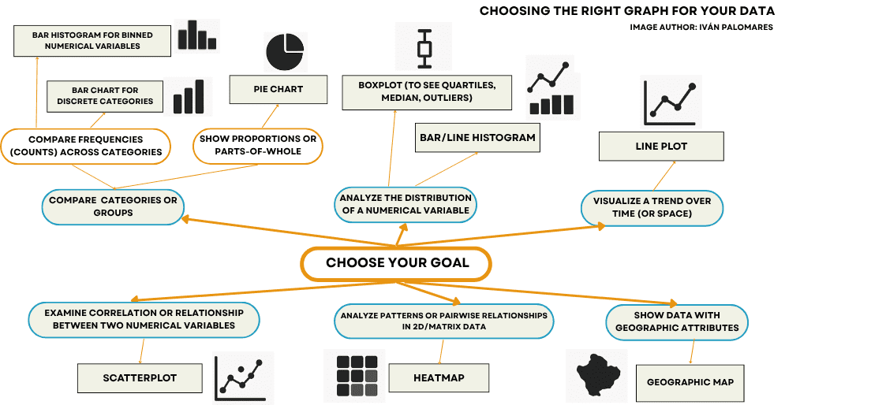{fig-align="center"}

------------------------------------------------------------------------

## Typy dat

### Kategoriální (kvalitativní) data

> Data, která vyjadřují určitou vlastnost nebo charakteristiku; jinými slovy data, která lze rozdělit do kategorií.

- **Nominální data**
  - data, která lze rozdělit do kategorií, mezi nimiž však neexistuje žádné přirozené pořadí
  - krevní skupina, barva očí, typ barvení buněk daného vzorku
- **Ordinální data**
  - data, která lze rozdělit do kategorií a zároveň je lze seřadit podle určitého pořadí
    - jednu kategorii lze tedy zařadit výše nebo níže než jinou
  - novorozenec, batole, dítě, dospívající, dospělý, senior
  - první, druhý, třetí - 1, 2, 3

------------------------------------------------------------------------

### Numerická (kvantitativní) data

> Data, která lze kvantifikovat a měřit

- **Intervalová data**
  - data, která lze vyjádřit jako hodnoty lišící se o určitý interval
    - stručně řečeno: běžné číselné hodnoty od minus nekonečna do plus nekonečna
  - stupně Celsia, nadmořská výška
- **Poměrová data (ratio)**
  - data, která lze vyjádřit jako hodnoty lišící se o určitý interval a která mají **definovanou nulovou hodnotu**, která umožňuje porovnávat velikosti pomocí poměrů
    - příkladem je hmotnost – něco nemůže mít přesně zápornou hmotnost v gramech
      - objekt X váží 20 gramů, objekt Y váží 40 gramů, objekt Y je tedy dvakrát těžší než objekt X
  - délka kosti, počet odebraných vzorků

::: callout-note
## Je možné změnit datový typ?

Ano, například převedením intervalových nebo poměrových dat na ordinální data - výšku v centimetrech můžeme rozdělit do kategorií podle výškových rozdílů po 5 cm.

**Jakmile víte, s jakým typem dat pracujete, můžete je upravovat pro potřeby vizualizace a hlavně vybírat vhodný typ grafu.**
:::

------------------------------------------------------------------------

## Vizualizace v R a RStudiu[^1]

[^1]: Upozornění: v některých případech (a při specifickém nastavení) se grafy mohou zobrazovat v **externím okně**.

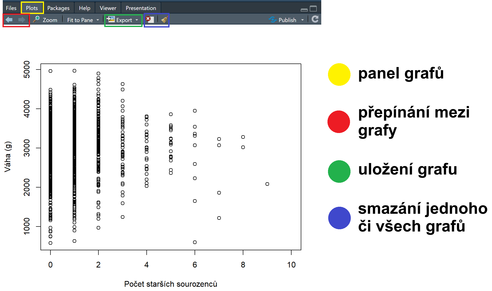{fig-align="center"}

------------------------------------------------------------------------

## `baseR` grafy

**R má pro spoustu grafů svoji vlastní funkci**. Před tím, než si je ovšem ukážeme, tak se naučíme argumenty, které mají společné - například určení barev, tloušťku čar, či ohraničení.

Spousta těchto argumentů je podobná i argumentům grafů vytvořených pomocí balíčku `ggplot`, jak si ukážeme později.

::: callout-note
## Proč nezačínat rovnou s `ggplot`?

Během této a následujících hodin budeme používat především balíček `ggplot`. Ten umožňuje vytváření grafů s obrovským množstvím svobody, pro **rychlou vizualizaci je ovšem poněkud zdlouhavý**, a jeho specifický syntax může být pro začátečníka s vizualizací složitý. Sám navíc přebírá určité principy z base R.
:::

------------------------------------------------------------------------

## Základní argumenty vizualizace v R

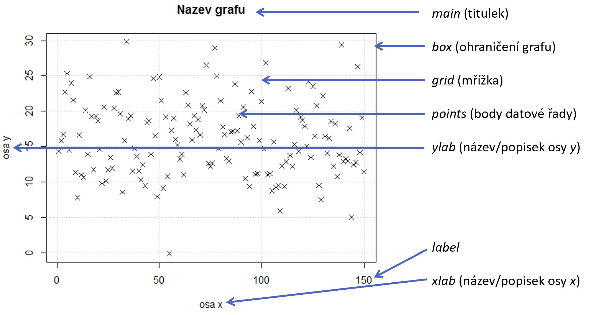{fig-align="center"}

------------------------------------------------------------------------

### Mapování dat pomocí funkce `plot`

Nejrychlejším způsobem, jak v R vytvořit graf, je pomocí fuknce `plot`.

```{r}
plot(
  x = iris$Sepal.Length, #osa x
  y = iris$Sepal.Width) #osa y
```

Můžete se také setkat s následujícím **zápisem závislosti**:

```{r}
plot(iris$Petal.Length ~ iris$Petal.Width)
```

A to je všechno? Co když si chceme udělat graf přesně dle našeho přání?

------------------------------------------------------------------------

### Ukázka grafu s nejčastěji používanými argumenty funkce `plot`

```{r}
#| output: false
#VYTVORENI GRAFU
plot(
  x = iris$Sepal.Length, #data pro osu x
  y = iris$Sepal.Width, #data pro osu y
  type = "p", #typ grafu - point
  
  #Body
  pch = 19, #typ bodu
  cex = 1.2, #velikost bodu
  col = "darkblue", #barva bodu
  
  #Popisky os
  xlab = "Sepal length",
  ylab = "Sepal width",
  
  #Nadpis
  main = "Relationship between sepal length and width",
  
  #Rozsah os
  xlim = c(min(iris$Sepal.Length), max(iris$Sepal.Length)),
  ylim = c(1.7, 4.8),
  
  #Barva os a popisku
  col.axis = "red", #barva hodnot os
  col.lab = "darkgreen", #barva popisku os
  col.main = "darkblue", #barva nadpisu
  
  #Velikost a vzhled textu
  cex.main = 1.4, #velikost nadpisu (standard 1)
  font.main = 2, #styl nadpisu (2 = bold)
  cex.lab = 0.8, #velikost popisku
  font.lab = 3, #styl popisku (3 = italic)
  lwd = 1.5) #tloustka linii (lwd je casty argument u doprovodnych car)

#PRIDANI LEGENDY
legend(
  "topright",
  legend = "specimen ID",
  col = "darkblue", #barva bodu
  pch = 19, #tvar bodu
  pt.cex = 1.2, #velikost bodu
  cex = 0.9, #tloustka boxu
  title = "Legend")

#PRIDANI POPISKU jednotlivych bodu
text(
  iris$Sepal.Length, #urceni pozice bodu na ose x
  iris$Sepal.Width, #urceni pozice bodu na ose y
  labels = rownames(iris), #co ma byt popisek
  pos = 3, #pozice
  cex = 0.7) #velikost
```

**Jaký je výsledek tohoto kódu?**

------------------------------------------------------------------------

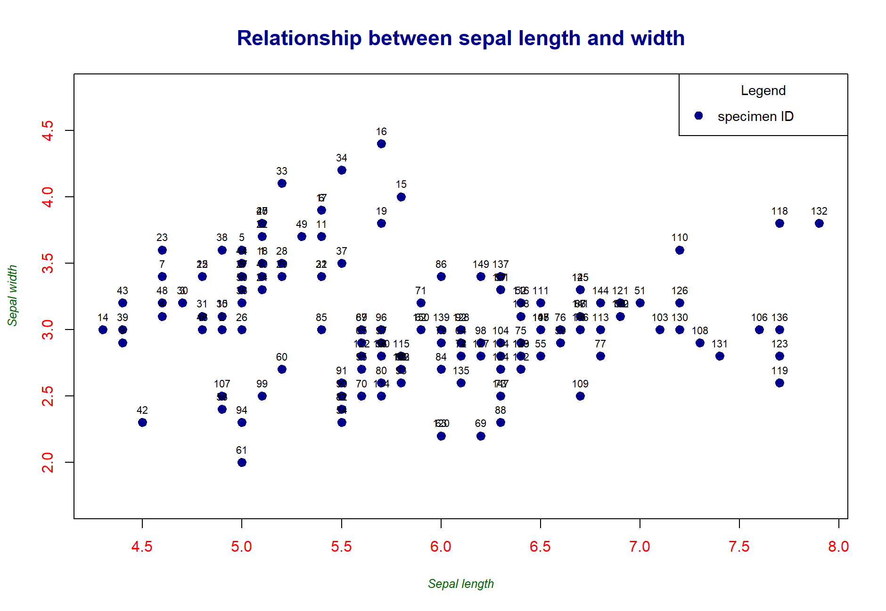{fig-align="center"}

------------------------------------------------------------------------

[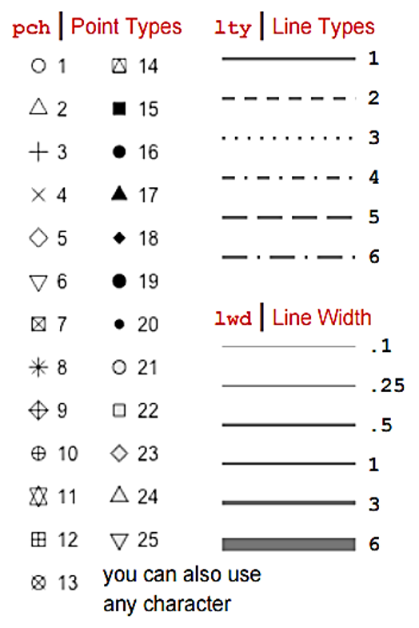{fig-align="center" width="470"}](http://www.gastonsanchez.com/visually-enforced/images/blog/par_cheatsheet.png)

------------------------------------------------------------------------

## Procvičení

1.  Máme dataset `women`, který obsahuje výšku žen v palcích a jejich váhu v librách (ano jedná se o americký dataset).

```{r}
head(women)
```

**Existuje vztah mezi tělesnou váhou a výškou?**

2.  Máme dataset `mtcars`, který v sobě obsahuje rozličné informace o jednotlivých značkách a typech aut.

Zajímá nás sloupec `mpg` aneb miles per gallon a `wt` aneb weight.

```{r}
head(mtcars)
```

Chceme si zjistit, jestli **je nějaký vztah mezi tím, jak je auto těžké, a jakou má spotřebu pohonných hmot na míli**.

------------------------------------------------------------------------

## Samostatné cvičení

```{r}
#| echo: false
countdown::countdown(minutes = 5,
                     seconds = 0,
                     start_immediately = FALSE,
                     warn_when = 120,
                     top = "0")
```

Máme dataset `trees`, který v sobě obsahuje informace o měření obvodu stromů v palcích (`Girth`) a jejich výšky ve stopách (`Height`).

Zkuste zjistit, jestli by **mezi sebou tyto proměnné mohly mít nějaký vztah**.

------------------------------------------------------------------------

## Řešení

```{r}
plot(
  trees$Girth ~ trees$Height,
  type = "p",
  pch = 19,
  col = "forestgreen")
```

------------------------------------------------------------------------

Co když ale chceme komplikovanější grafy? Jak jsme navíc viděli na začátku, ne každou informaci lze přehledně vyjádřit jednoduchým bodovým grafem.

**Jaký graf vybereme pro jaký typ vizualizace?**

Na následujícím snímku máte stručný tahák toho, kdy se jaký typ grafu používá v závislosti na zkoumaných datech.

Během dnešní hodiny si probereme základní typy: sloupcové, bodové a čárové grafy.

Budeme si ukazovat jejich provedení jak v baseR, tak pomocí balíčku `ggplot`.

------------------------------------------------------------------------

### Cheatsheet volby grafu

| Co chci zjistit?                  | Jaký graf použít?                    |
|-----------------------------------|--------------------------------------|
| Porovnání kategorií (skupin)      | Bar plot, boxplot                    |
| Rozložení numerických hodnot      | Histogram, density plot, violin plot |
| Vztah dvou numerických proměnných | Scatter plot                         |
| Změny v čase                      | Line chart                           |
| Podíly kategorií                  | Pie chart, stacked bar plot          |
| Odlehlé hodnoty                   | Boxplot, scatter plot                |

------------------------------------------------------------------------

## Barplot

> graf určený k vizualizaci vztahu a hodnot kategoriálních dat

Novorozenci podle úrovně dosaženého vzdělání matky `edu.M`.

```{r}
barplot(table(dataNewborns$edu.M),
  xlab = "Vzdělání matky",
  ylab = "Počet",
  col = c("lightblue", "magenta", "yellow", "red"))
```

------------------------------------------------------------------------

### Co je funkce table?

Pro barplot je třeba mít **soupis jednotlivých kategorií, které má zobrazit na ose x a jejich numerické hodnoty** (počet, průměr, medián...)

> Funkce `table` vytvoří kontingenční tabulku absolutních četností jednotlivých úrovní faktoru.

```{r}
table(dataNewborns$edu.M)
```

Ukázka: kolik máme novorozenců dle pohlaví?

```{r}
table(dataNewborns$sex.C)
```

------------------------------------------------------------------------

## Procvičení - barplot

Pracujeme s datasetem `dataNewborns`.

**Zobraz kolik novorozenců bylo jakého pohlaví.**

------------------------------------------------------------------------

## Histogram

> graf zobrazující distribuci kontinuálních numerických dat

Jaká je distribuce váhy novorozenců?

```{r}
hist(dataNewborns$weight.C,
     labels = TRUE, #popisky jednotlivych hodnot
     ylim = c(0, 500)) #urceni velikosti osy y - aby se nam tam ty popisky vesly
```

------------------------------------------------------------------------

Jaká je distribuce délky okvětních plátků? (`iris$Petal.Width`)

```{r}
hist(iris$Petal.Length)
```

------------------------------------------------------------------------

Hm... proč je najednou víc těch třídících kontejnerů?

::: callout-note
## Sturgesovo pravidlo počtu kontejnerů

Počet kotejnerů (jednotlivých sloupců) je proměnlivý - čím větší rozptyl, tím více kontejnerů.

Jeden z nejvíce používaných způsobů výpočtu počtu kontejnerů je takzvané **Sturgesovo pravidlo**.

Funkce `hist` ho používá implicitně (argument `breaks = "Sturges"`), ale například u `ggplot` bude třeba si počet kontejnerů spočítat.

```{r}
#samotny vypocet
ceiling(1 + 3.3 * log10(length(iris$Petal.Length)))
#existuje pro to ovsem fce
nclass.Sturges(iris$Petal.Length)
```
:::

------------------------------------------------------------------------

## Čárový graf (line chart)

> graf který zobrazuje vývoj specifické numerické hodnoty - obvykle používán pro časové řady, kdy osa x je kontinuální vývoj ukazující trendy

Dataset `Nile` obsahuje údaje o ročním průtoku vody v řece Nil v Egyptě v letech 1871-1970.

Po ukázce plotu si vysvětlíme, co jsou to **časové řady**.

------------------------------------------------------------------------

```{r}
plot(Nile,
  type = "l", #l - line chart
  col = "#4682b4", #hex kod barvy
  lwd = 2, #sirka cary
  xlab = "Rok",
  ylab = "Průtok řeky",
  main = "Vývoj ročních hodnot průtoku řeky Nil")
```

------------------------------------------------------------------------

### Časové řady

> Časová řada je soubor hodnot určité proměnné, které jsou zaznamenávány postupně v čase.

**Jednoduše řečeno: sledujeme, jak se nějaká veličina mění v průběhu času.**

- jak se mění teplota během jednotlivých měsíců
- jak se mění počet narozených dětí v jednotlivých letech
- jak se mění cena akcií během jednotlivých dnů

```{r}
Nile
str(Nile)
```

------------------------------------------------------------------------

## Procvičení - linechart

Dataset `UKgas` obsahuje čtvrtletní spotřebu plynu ve Velké Británii v letech 1960–1986.

**Zjisti, jak se vyvíjela spotřeba plynu.**

------------------------------------------------------------------------

## Bodový graf (scatter plot)

> graf který zobrazuje vztah mezi dvěmi numerickými hodnotami, kdy každá hodnota je vyjádřena jedním bodem

Scatter plot jsme si defakto ukazovali již na začátku dnešní lekce - **jedná se o jeden z nejzákladnějších grafů v R**.

------------------------------------------------------------------------

```{r}
plot(
  women$height ~ women$weight,
  type = "p", #p - point typ grafu
  pch = 14,
  col = "purple")
```

------------------------------------------------------------------------

## Samostatné cvičení - baseR vizualizace

```{r}
#| echo: false
countdown::countdown(minutes = 5,
                     seconds = 0,
                     start_immediately = FALSE,
                     warn_when = 120,
                     top = "0")
```

V datasetu `chickwts` máme přehled váhy jednotlivých kuřat v závisosti na jejich krmivu.

**Jak byla jednotlivá krmiva zastoupena?**

------------------------------------------------------------------------

## Řešení - baseR vizualizace

V datasetu `chickwts` máme přehled váhy jednotlivých kuřat v závisosti na jejich krmivu. **Jak byla jednotlivá krmiva zastoupena?**

::: fragment
1.  Zobrazíme si hlavičku a strukturu datasetu.

```{r}
head(chickwts)
str(chickwts)
```
:::

::: fragment
2.  Vidíme, že se jedná o kategoriální data, použijeme proto barplot.

```{r}
barplot(table(chickwts$feed),
        xlab = "druh krmiva",
        ylab = "počet krmených kuřat",
        main = "Zastoupení krmiv v datasetu",
        col = rainbow(length(table(chickwts$feed))))
```
:::

------------------------------------------------------------------------

## Vizualizace pomocí balíčku `ggplot2`

V předchozí části jsme se seznámili s principy základních typů grafů a ukázali si, jak je vytvořit v baseR. Nyní se přesuneme k balíčku `ggplot2`.

### K čemu balíček slouží a čím se liší?

Pomocí `ggplot2` si můžeme vytvářet grafy na publikační úrovni. Oproti baseR máme i **mnohem širší možnosti personifikace vzhledu grafu** a ve výsledku i přehlednější syntax.

::: callout-warning
## Každý graf bude pouze tak dobrý jako podkladová data

Je extrémně důležité, abyste přemýšleli nejenom nad tím, jestli můžete daný graf používat na vašich datech, ale abyste **prováděli důslednou kontrolu a případnou úpravu dat, které budete vizualizovat**.

Jsou všechna kategorická data faktory? Pokud je to relevantní, odstranili jste `NA` hodnoty?
:::

------------------------------------------------------------------------

## `ggplot` syntax

Samotná vizualizace se pak provádí pomocí funkce `ggplot`. V této sekci si probereme základní syntax, ze kterého vychází všechny následující vizualizace.

<<<<<<< Updated upstream
- **`ggplot()` funkce:**
  - **argument `data`:** Jaká data chceme vizualizovat?
  - **argument `aes()`:** Jak chceme tato data vizualizovat? Které sloupce/části? Co bude osa x/y? Chceme data rozdělit podle určitých skupin?
    - veškeré parametry definované v `aes` budou aplikované na celý graf, včetně `geom` hodnot
- **`geom_*()` vrstva:** Který typ grafu má vzniknou? (point, histogram, bar...) Jak má samotný tento graf vypadat?
=======
- `ggplot()` funkce:
  - argument `data`: jaká data chceme vizualizovat?
  - argument `aes()`: Jak chceme tato data vizualizovat? Které sloupce/části? Co bude osa x/y? Chceme data rozdělit podle určitých skupin?
    - veškeré paramtery definované v `aes` budou aplikované na celý graf, včetně `geom` hodnot
- `geom_*()` vrstva: Který typ grafu má vzniknou? (point, histogram, bar...) Jak má samotný tento graf vypadat?
>>>>>>> Stashed changes
  - je možné vrstvit několik `geom` vrstev na sebe
  - pokud potřebují dodefinovat další data k mapování, **provádí se to pomocí jejich vlastního `aes()`argumentu**

**Jednotlivé vstvy a funkce se spojují dohromady symbolem `+`.**

------------------------------------------------------------------------

### Barplot v `ggplot`

Vytvořme si základní barplot, na kterém si prakticky ukážeme syntax a korespondující `geom_*` vrstvu.

```{r}
ggplot(data = dataNewborns, #mapujeme dataNeborns
  aes(x = edu.M)) + #osa x maji byt hodnoty z edu.M
  geom_bar() #chceme barplot
```

------------------------------------------------------------------------

### Histogram v `ggplot`

Jakým způsobem si vytvoříme základní histogram? Zobrazme si histogram ukazující distribuci váhy novorozenců.

```{r}
ggplot(dataNewborns,
  aes(x = weight.C)) +
  #vyzkousejte si co by se stalo bez argumentu bins
  geom_histogram(bins = nclass.Sturges(dataNewborns$weight.C))
```

------------------------------------------------------------------------

## Čárový graf v `ggplot`

Narozdíl od baseR, v `ggplot` je tvorba line chartu o něco složitější - `ggplot` **vyžaduje jasně definované hodnoty x/y**.

Musíme proto dle těchto potřeb data upravit.

```{r}
Nile_df <- data.frame(
  year = as.numeric(time(Nile)),
  flow = as.numeric(Nile))
head(Nile_df)
```

------------------------------------------------------------------------

Nyní můžeme přejít k samotné vizualizaci.

```{r}
ggplot(Nile_df, aes(x = year, y = flow)) +
  geom_line()
```

------------------------------------------------------------------------

## Bodový graf v `ggplot`

Přestože baseR umožňuje rychlou tvorbu tohoto typu grafu, byla by škoda neukázat si možnosti jeho vytvoření v `ggplot` a to nejenom kvůli možnosti rozdělování do skupin, jak si ukážeme v následující sekci.

------------------------------------------------------------------------

Vytvořme si graf závislosti šířky a délky okvětního kalichu v datatsetu `iris`.

```{r}
ggplot(iris, aes(x = Sepal.Length, y = Sepal.Width)) + 
    geom_point() #bodovy graf
```

------------------------------------------------------------------------

A... to je všechno? Vždyť to ani nevypadá nijak hezky?

Jak bylo řečeno, `ggplot` umožňuje nepřeberné množství úprav grafu.

**Zkusme si proto třeba na barplotu ukázat, jaké veškeré kulišárny lze s tímto balíčkem provádět.**

------------------------------------------------------------------------

### Barvy a tvary (nejen) kontejneru

```{r}
#| code-line-numbers: "3-5"

ggplot(data = dataNewborns,
       aes(x = edu.M)) +
  geom_bar(fill = "red", #jakou chceme barvu kontejneru
           colour = "darkgreen", #jaky maji mit obrys
           width = 0.7) #a jak maji byt siroke?
```

------------------------------------------------------------------------

### Popisky

Všimněte si **přidání nových vrstev `geom_text()` a `labs()`**!

```{r}
#| output: false
#| code-line-numbers: "6-13"

ggplot(data = dataNewborns,
       aes(x = edu.M)) +
  geom_bar(fill = "red",
           colour = "darkgreen",
           width = 0.7) +
  #vypis hodnoty z osy y (soucet aka count) - podivejte se na puvodni popisek osy y
  geom_text(stat = "count", 
            aes(label = after_stat(count)), #namapuj to jako popisek kontejneru
            size = 4, #velikost textu
            vjust = 2) + #umisti popisky ve vzdalenosti 2 od okraje
  labs(title = "Počet novorozenců dle úrovně vzdělání matky", #jaky ma byt nadpis 
       x = "Úroveň vzdělání matky", #popis osy x
       y = "Počet dětí") #popis osy y
```

------------------------------------------------------------------------

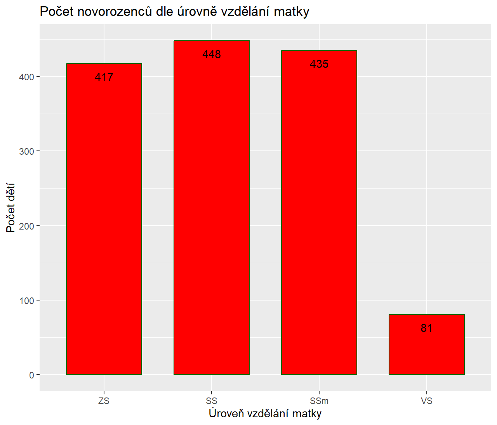

------------------------------------------------------------------------

### Změna pozadí

Je možné upravit si i pozadí a celkový vizuál podkladu grafu.

```{r}
#| output: false
#| code-line-numbers: "12"

ggplot(data = dataNewborns,
       aes(x = edu.M)) +
  geom_bar(fill = "red",
           colour = "darkgreen",
           width = 0.7) +
  geom_text(stat = "count", 
            aes(label = after_stat(count)),
            vjust = 2) +
  labs(title = "Počet mnovorozenců dle úrovně vzdělání matky", 
       x = "Úroveň vzdělání matky",
       y = "Počet dětí") +
  theme_minimal() #chci tento typ vizualu
```

------------------------------------------------------------------------

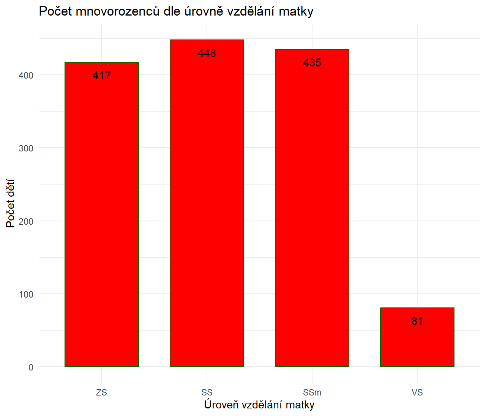{fig-align="center"}

------------------------------------------------------------------------

### Rozdělení podle kategorii

Co kdybychom chtěli mít hodnoty rozdělené nejenom podle jedné ale i dle více kategorií?

::: callout-important
## Rozdělení podle levels faktorů

Při rozdělování je třeba, aby R dokázalo hodnoty brát jako samostatné kategorie - **dané hodnoty musí být faktor!**
:::

```{r}
#| output: false
#| code-line-numbers: "3,8,9,13"

ggplot(data = dataNewborns,
       aes(x = edu.M,
           fill = sex.C)) + #rozdel kontejnery dle pohlavi
  geom_bar(colour = "darkgreen",
           width = 0.7) +
  geom_text(stat = "count",
            aes(label = after_stat(count)),
            #musime si upravit pozici popisku
            position = position_stack(vjust = 0.8)) +
  labs(title = "Počet novorozenců dle úrovně vzdělání matky",
       x = "Úroveň vzdělání matky",
       y = "Počet dětí",
       fill = "Sex") + #popisek legendy
  theme_minimal()
```

------------------------------------------------------------------------

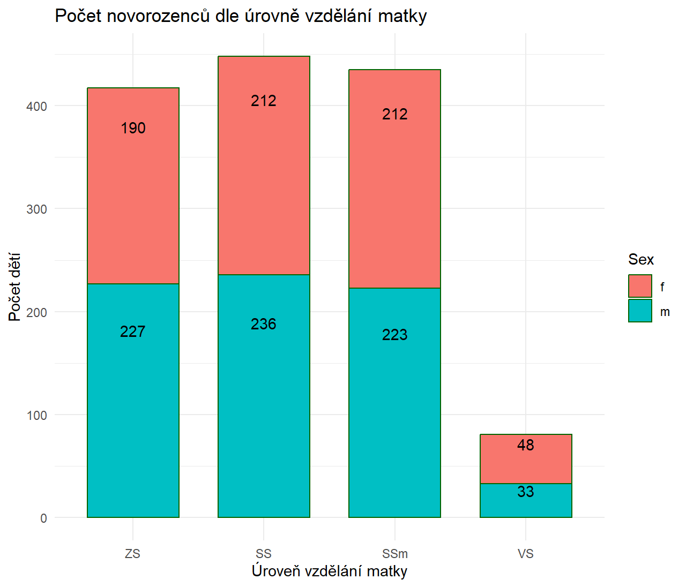{fig-align="center"}

------------------------------------------------------------------------

Co když ale **kategorie chceme mít vedle sebe**?

```{r}
#| output: false
#| code-line-numbers: "6,9,10"

ggplot(data = dataNewborns,
       aes(x = edu.M,
           fill = sex.C)) + 
  geom_bar(colour = "darkgreen",
           width = 0.7,
           position = "dodge") + #popisky vedle sebe
  geom_text(stat = "count",
            aes(label = after_stat(count)),
            #jak se maji vedle sebe popisky poskladat
            position = position_dodge(width = 0.7),
            vjust = -0.5) +
  labs(title = "Počet novorozenců dle úrovně vzdělání matky",
       x = "Úroveň vzdělání matky",
       y = "Počet dětí",
       fill = "Sex") +
  theme_minimal()
```

------------------------------------------------------------------------

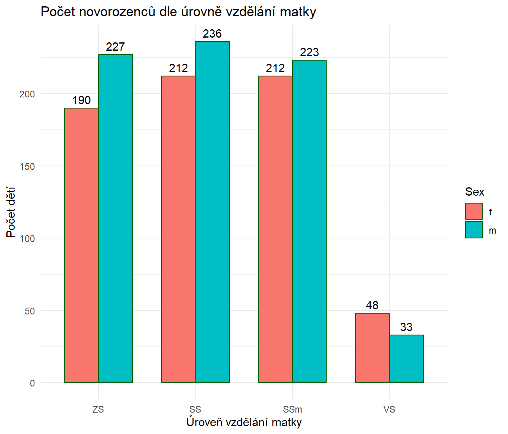{fig-align="center"}

------------------------------------------------------------------------

## Samostatné cvičení - barplot

```{r}
#| echo: false
countdown::countdown(minutes = 10,
                     seconds = 0,
                     start_immediately = FALSE,
                     warn_when = 120,
                     top = "0")
```

Z hodnot v datasetu `dataNewborns` pomocí funkcí z balíčku `ggplot2` vtvořte graf, který bude znázorňovat rozdělení novorozenců podle počtu jejich starších sourozenců (`prch.N`). Rozdělte novorozence dle pohlaví (`sex.C`).

Nejdříve si vytvořte jednoduchý holý graf, abyste zjistili, že vám kód běží - **až později si do něj přidávejte další funkce a vylepšení**.

Pohrajte si s barvami, velikostmi, pozadím... nebojte se googlit :\].

------------------------------------------------------------------------

## Řešení - barplot

**Z hodnot v datasetu `dataNewborns` pomocí funkcí z balíčku `ggplot2` vtvořte graf, který bude znázorňovat rozdělení novorozenců podle počtu jejich starších sourozenců (`prch.N`). Rozdělte novorozence dle pohlaví (`sex.C`).**

::: fragment
1.  Podívejme se na to, s jakými daty pracujeme

```{r}
str(dataNewborns)
```
:::

::: fragment
2.  Hodnoty ve sloupci `prch.N` jsou numerické, je třeba je změnit na faktory.

```{r}
dataNewborns$prch.N <- as.factor(dataNewborns$prch.N)
```
:::

::: fragment
3.  Následně již můžeme vytvořit graf - zde je jedna z možných variant.

```{r}
#| output: false
ggplot(dataNewborns, aes(x = prch.N, fill = sex.C)) +
  geom_bar(
    position = "dodge",
    color = "white") +
  geom_text(
    stat = "count",
    aes(label = after_stat(count)),
    position = position_dodge(width = 1),
    vjust = -0.3,
    colour = "white", #barva textu
    size = 3) + #velikost textu
  labs(
    title = "Počet dětí podle počtu starších sourozenců",
    x = "Počet starších sourozenců",
    y = "Počet dětí",
    fill = "Pohlaví") +
  theme_dark()
```
:::

------------------------------------------------------------------------

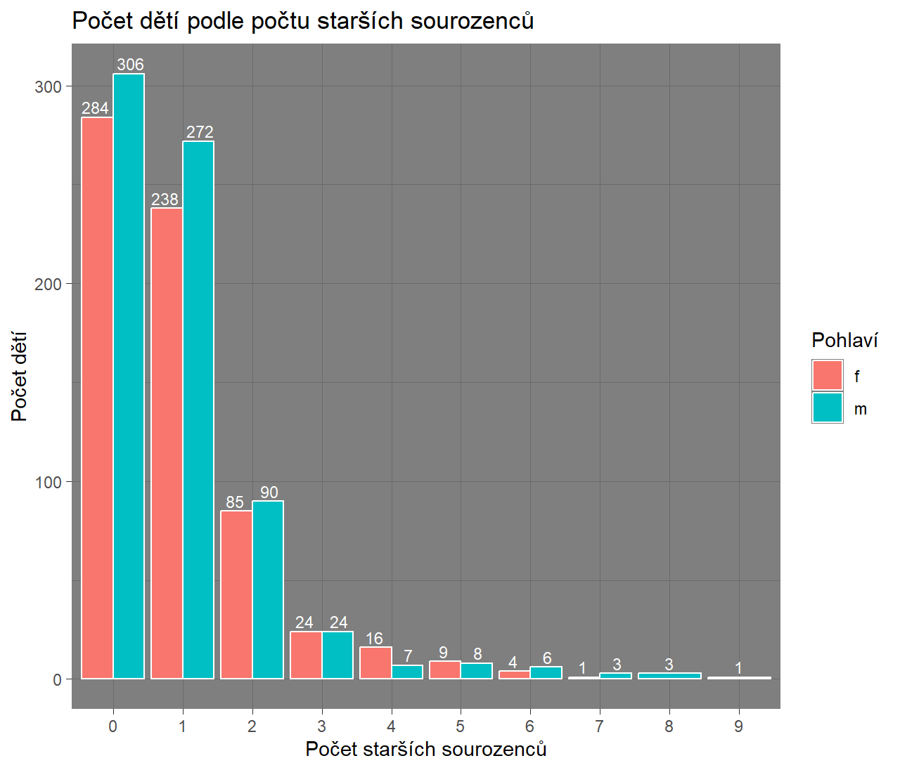{fig-align="center"}

------------------------------------------------------------------------

Existuje samozřejmě i mnoho dalších argumentů a `ggplot2` funkcí.

**Bohužel, jediným způsobem, jakým se naučíte všechny ty funkce, které by se vám hodili nejvíc je, že si sami funkce budete opakovaně zkoušet.**

Během dneška (a ani zítřka, či pozítří) bychom si všechny funkce projít nestihli, proto dostanete na [Kde hledat dál] odkazy na několik stránek, které vám mohou sloužit jako skvělý start pro vaše další sebevzdělávání.

**A v mezičase si ukážeme pár funkcí a argumentů, co lze použít u histogramu.**

------------------------------------------------------------------------

### Linie statistických hodnot

Přes histogram (a i jiné grafy) si **můžeme namapovat linie určující statistické hodnoty**.

Zde si ukážeme vytvoření linie, která bude určovat průměr hodnot.

```{r}
#| output: false
#| code-line-numbers: "6-10"
ggplot(data = dataNewborns) +
  aes(x = weight.C) +
  geom_histogram(bins = nclass.Sturges(dataNewborns$weight.C),
                 color = "black",
                 fill = "pink") +
  #urci prumer a namapuj ho na osu x
  geom_vline(aes(xintercept = mean(weight.C)),
             color = "blue",
             linetype = "dashed", #typ linie
             linewidth = 1) #sirka linie
```

------------------------------------------------------------------------

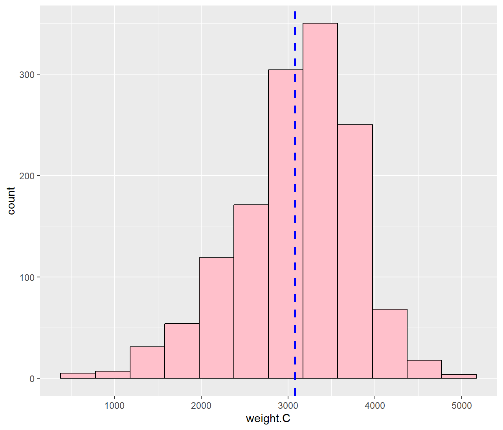{fig-align="center"}

------------------------------------------------------------------------

### Překrývaní se grafů a průhlednost

Při rozdělování histogramu podle kategorií se nám může stát, že **grafy se budou navzájem překrývat.** V takovém příadě se hodí udělat je částečně průhlednými.

```{r}
#| output: false
#| code-line-numbers: "3,5,6"

ggplot(data = dataNewborns) +
  aes(x = weight.C,
      fill = sex.C) + #rozdel podle pohlavi
  geom_histogram(bins = nclass.Sturges(dataNewborns$weight.C),
                 alpha = 0.4, #pruhlednost 40 %
                 position = "identity") + #prekryj grafy pres sebe
  geom_vline(aes(xintercept = mean(weight.C)),
             color = "blue",
             linetype = "dashed",
             linewidth = 1) +
  labs(title="Distribuce váhy novorozenců", 
       x = "Váha (g)",
       y = "Počet",
       fill = "Sex")
```

------------------------------------------------------------------------

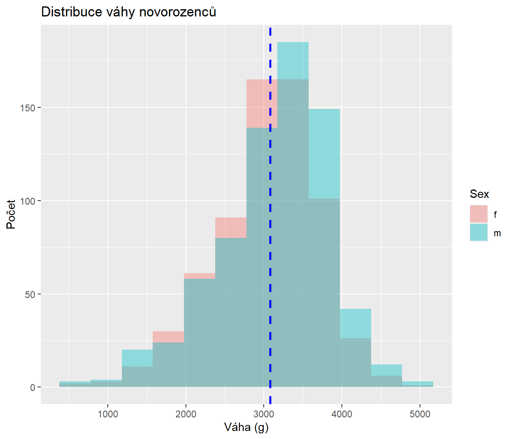

------------------------------------------------------------------------

## Linie statistických hodnot pro každou kategorii

Nejdříve si **musíme vytvořit hodnoty (v tomto případě průměry), které mají být namapovány**.

```{r}
meanWeightSex <- dataNewborns %>% 
  group_by(sex.C) %>% 
  summarise(mean_weight = mean(weight.C)); meanWeightSex
```

Následně je můžeme použít v grafu.

```{r}
#| output: false
#| code-line-numbers: "7-9,16"

ggplot(data = dataNewborns) +
  aes(x = weight.C,
      fill = sex.C) +
  geom_histogram(bins = nclass.Sturges(dataNewborns$weight.C),
                 alpha = 0.4,
                 position = "identity") +
  geom_vline(data = meanWeightSex, #namapuj udaje z meanWeightSex
             aes(xintercept = mean_weight, #pouzij data z tohoto sloupce
                 colour = sex.C), #delime grafy podle pohlavi tak at sedi barvy
             linetype = "dashed",
             linewidth = 1) +
  labs(title="Distribuce váhy novorozenců", 
       x = "Váha (g)",
       y = "Počet",
       fill = "Sex",
       color = "Sex") #pridani car do legendy
```

------------------------------------------------------------------------

{fig-align="center"}

------------------------------------------------------------------------

### Rozdělení jednotlivých kategorií do individuálních grafů

Co když ale chceme, aby **každá kategorie měla vlastní graf**?

```{r}
#| output: false
#| code-line-numbers: "5-6"

ggplot(data = dataNewborns,
       aes(x = weight.C, fill = sex.C)) +
  geom_histogram(
    bins = nclass.Sturges(dataNewborns$weight.C)) +
  facet_grid(sex.C ~ ., #rozdel do individualnich grafu dle levels sex.C
             scales = "free") + #kazdy graf muze mit jine xlim a ylim
  labs(
    title = "Distribuce váhy novorozenců",
    x = "Váha (g)",
    y = "Počet",
    fill = "Pohlaví") +
  theme_minimal()
```

------------------------------------------------------------------------

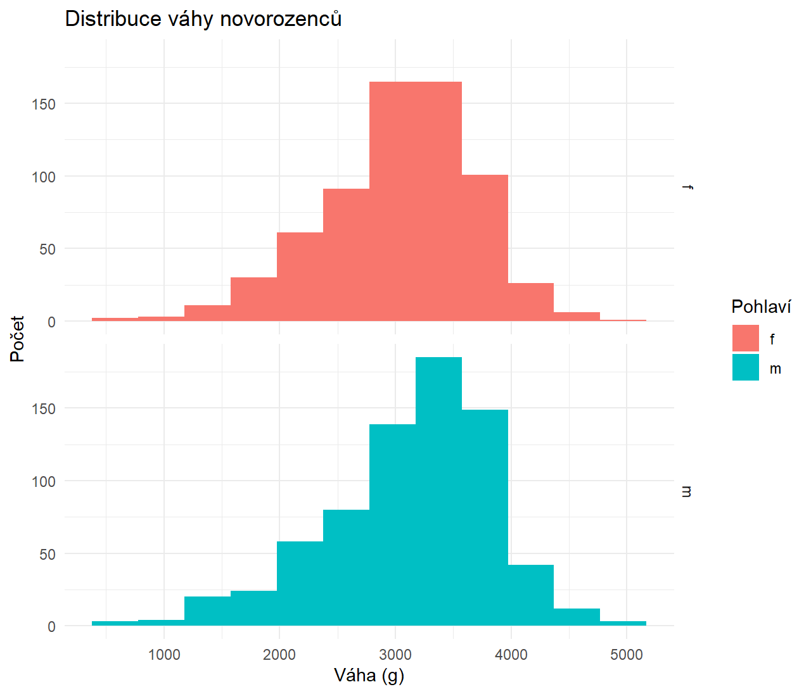{fig-align="center"}

------------------------------------------------------------------------

### Upravení barev

Argument `fill` určuje barvy automaticky. **Co když si ale chceme barvy kategorií vybrat?**

```{r}
#| output: false
#| code-line-numbers: "5-6"

ggplot(data = dataNewborns,
       aes(x = weight.C, fill = sex.C)) +
  geom_histogram(
    bins = nclass.Sturges(dataNewborns$weight.C)) +
  #nastaveni specifickych barev pro fill
  scale_fill_manual(values = c("m" = "pink", "f" = "lightgreen")) +
  labs(
    title = "Distribuce váhy novorozenců",
    x = "Váha (g)",
    y = "Počet",
    fill = "Pohlaví") +
  theme_minimal()
```

------------------------------------------------------------------------

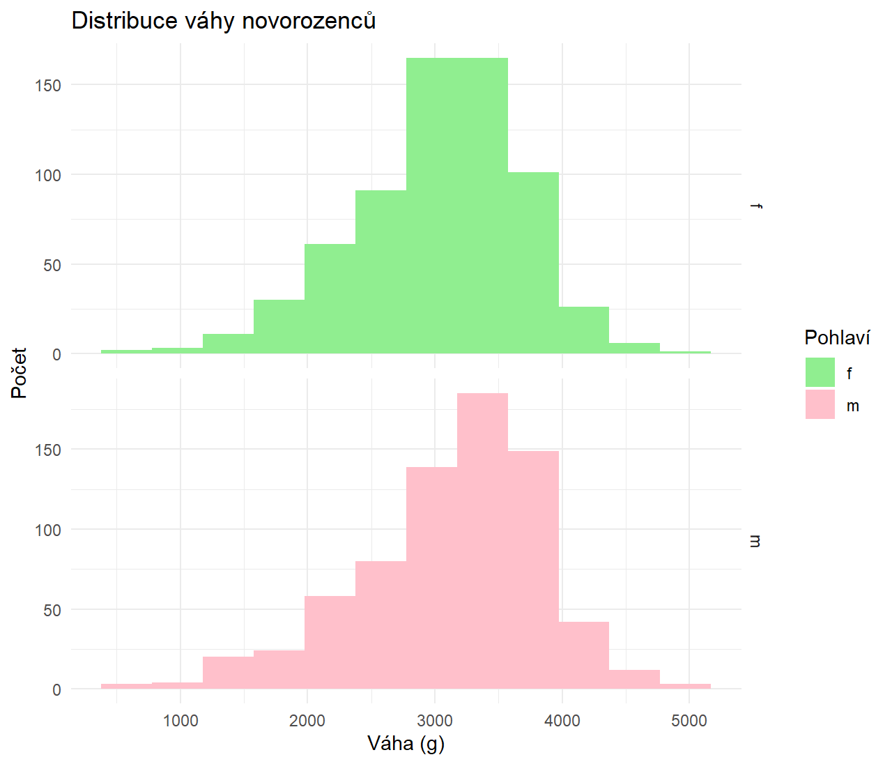{fig-align="center"}

------------------------------------------------------------------------

## Kde hledat dál

[The R Graph Gallery](https://r-graph-gallery.com/)

Jeden z nejlepších a nejpčehlednějších webů s ukázkou tvorby snad každého typu grafu.

[R Graphics Cookbook](https://r-graphics.org/)

Učebnice, která do podrobna rozebírá možnosti vizualizace dat. Pracuje především s `ggplot2`.

[R Color Palettes: The Complete Reference](https://www.datanovia.com/blog/r-color-palettes)

Seznámení se s barevnými paletami v R a jejich podrobný přehled.

------------------------------------------------------------------------

## Domácí úkol

1.  Z datasetu `datanewborns` zjistěte a zobrazte průměrnou váhu novorozence v závislosti na jeho pohlaví a počtu starších sourozenců.

2.  Máme dataset `diamonds` v R, která v sobě obsahuje informace o typu a hodnotě jednotlivých diamantů. Pomocí grafu ukaž, jaká je distribuce ceny (`price`) na základě kvality zpracování (`cut`).

Skript s výpočtem zašlete nejpozději do pátku před příští hodinou na [lucie.hoskova\@ruk.cuni.cz](mailto:lucie.hoskova@ruk.cuni.cz)

------------------------------------------------------------------------

## Tipy navíc pro samostudium

### Barvy v R

**Všechny barvy dostupné v baseR:**

[PDF](luc-hoskova.github.io/introR_CUNI/materialy/06_vizualizace_uvod/Rcolors.pdf) s jejich názvy a zobrazením

```{r}
colors()
```

<<<<<<< Updated upstream
Zápis pomocí hexcode:
=======
**Hexcode:**
>>>>>>> Stashed changes

```{r}
plot(cars$speed,
     cars$dist,
     col = "#1F77B4")
```

<<<<<<< Updated upstream
Zápis pomocí RGB:
=======
**RGB:**
>>>>>>> Stashed changes

```{r}
plot(
  cars$speed,
  cars$dist,
  pch = 19,
  col = rgb(1, 0, 0, 0.5))
```

<<<<<<< Updated upstream
Tvorba vlastní palety:
=======
**Palety:**

Palety jsou defacto funkce/objekty, které v sobě mají uložený seznam barev.

```{r}
heat.colors(5)
rainbow(5)
```

**Tvorba vlastní palety:**
>>>>>>> Stashed changes

```{r}
my_cols <- c(
  "steelblue",
  "darkorange",
  "forestgreen")

plot(
  iris$Sepal.Length,
  iris$Sepal.Width,
  col = my_cols[iris$Species],
  pch = 19)
<<<<<<< Updated upstream

legend(
  "topright",
  legend = levels(iris$Species),
  col = my_cols,
  pch = 19,
  title = "Species")
=======
>>>>>>> Stashed changes
```
