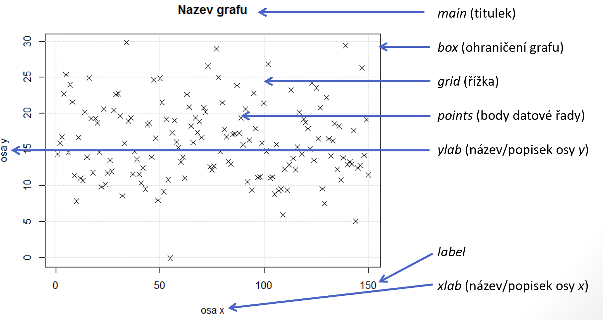

## Program

::: incremental
- opakování z minulé hodiny
- kontrola domácího úkolu
- co je to a proč vizualizace
- typy dat
- vizualizace v R
:::

------------------------------------------------------------------------

## Kontrola domácí práce

```{r}
#| context: setup
#| echo: false
library(tidyverse)
```

### Úloha 1

**Byla naměřena následující koncentrace látky:**

```{r}
koncentrace <- c("vzorek1" = "75 mg/l",
                 "vzorek2" = "101 mg/l",
                 "vzorek3" = "158 mg/l",
                 "vzorek4" = "48 mg/l")
```

- Pokud je koncentrace vyšší než 100 mg/l, vypište „Vysoká koncentrace“.
- Pokud je koncentrace mezi 50 a 100 mg/l včetně, vypište „Normální koncentrace“.
- Jinak vypište „Nízká koncentrace“.

::: fragment
1.  Vytvoříme si vektor s pouze číselními hodnotami.

    ```{r}
    hodnoty <- parse_number(koncentrace); hodnoty
    ```
:::

::: fragment
2.  Přepišme si jednotlivé hodnoty pomocí zadaného klíče.

    ```{r}
    hodnoty <- case_when(
      hodnoty > 100 ~ "Vysoká koncentrace",
      hodnoty >= 50 & hodnoty <= 100 ~ "Normální koncentrace",
      .default = "Nízká koncentrace"); hodnoty
    ```
:::

::: fragment
3.  Můžeme si pro snadnější porozumnění přidat názvy jednotlivých hodnot.

    ```{r}
    names(hodnoty) <- names(koncentrace)
    hodnoty
    ```
:::

------------------------------------------------------------------------

### Úloha 2

**V laboratorní kultuře je na začátku 200 bakterií. Počet bakterií se každou hodinu zvýší o 30 %. Kolik jich bude po osmi hodinách?**

::: fragment
1.  Vytvořme si základní hodnotu.

    ```{r}
    bakterie <- 200
    ```
:::

::: fragment
2.  Projeďme si množství bakterií v osmi cyklech a zobrazme si výslednou hodnotu.

    ```{r}
    for (hodina in 1:8) {
      bakterie <- bakterie * 1.3
    }

    bakterie
    ```
:::

------------------------------------------------------------------------

### Úloha 3

**Během pokusu jsme čtyři vzorky vystavily třem látkám a změřili jejich reaktivitu.**

```{r}
mereni <- matrix(
  c(12, 15, 18, 20, 25, 30,
  8,  10, 12, 35, 40, 45),
  nrow = 4, byrow = TRUE)

rownames(mereni) <- c("Vzorek 1", "Vzorek 2",
                      "Vzorek 3", "Vzorek 4")
colnames(mereni) <- c("Latka A", "Latka B", "Latka C")
```

- Jaká je průměrná reaktivita každého vzorku?
- Jaké byly nejvyšší hodnoty způsobené reaktivity pro každou látku a která látka způsobila největší reaktivitu?

::: fragment
1.  Spočítáme si průměrnou reaktivitu každého vzorku.

    ```{r}
    apply(mereni, 1, mean)
    ```
:::

::: fragment
2.  Spočítejme si průměrnou reaktivitu každé látky a z ní vyberme tu nejreaktivnější.

    ```{r}
    maxima <- apply(mereni, 2, max); maxima
    max(maxima)
    which.max(maxima) #pokud chceme zjistit nazev a pozici
    maxima[which.max(maxima)] #a pokud si ji chceme i vypsat
    ```
:::

------------------------------------------------------------------------

### Úloha 4

**U pacientů byly naměřeny následující hodnoty glukózy v krvi (mmol/l):**

```{r}
c(8.5, 3.9, 5.9, 4.0, 4.5, 9.0, 6.3, 5.1, 7.0, 4.8, 7.2, 4.2)
```

**Množství cukru v krvi se dělí dle následující tabulky:**

| Stav          | Hodnoty   |
|---------------|-----------|
| Norma nalačno | 3.9 - 5.5 |
| Prediabetes   | 5.6 - 6.9 |
| Cukrovka      | ≥ 7.0     |

**Vytvořte přehlednou tabulku, kdy pro každého pacienta napíšete jejich ID dle pořadí, jejich naměřenou hodnotu a stav podle tabulky.**

::: fragment
1.  Pro snadnější práci si hodnoty uložíme do pojmenované proměnné.

```{r}
glukoza <- c(8.5, 3.9, 5.9, 4.0, 4.5, 9.0, 6.3, 5.1, 7.0, 4.8, 7.2, 4.2)
```
:::

::: fragment
2.  Následně si vytvoříme nový data frame `pacienti`, kdy pro tvorbu jednotlivých sloupců použijeme hodnoty z `glukoza` a tabulky kategorizace.

```{r}
  pacienti <- data.frame(
    ID = 1:length(glukoza),
    Hodnota = glukoza,
    Stav = case_when(
      glukoza >= 3.9 & glukoza < 5.6 ~ "Norma nalačno",
      glukoza >= 5.6 & glukoza < 7 ~ "Prediabetes",
      glukoza >= 7.0 ~ "Cukrovka",
      .default = "Mimo běžné rozmezí"))
```
:::

------------------------------------------------------------------------

## K čemu slouží vizualizace

::: incremental
1.  Předávání informací o datech
2.  Vizuální kontrola dat
:::

:::: fragment
::: callout-note
## Vizualizace není pouze finální výsledek

Vizualizace je pouhé zobrazení dat - **je dobré ji využívat i v průběhu samotné datové analýzy**.

Co když chceme například rychle zjistit hrubou korelaci mezi `Sepal.Length` a `Sepal.Width` u datasetu `iris`? Dle naší hypotézy nezávisí na odrůdě.

```{r}
colors <- c("red", "blue", "green")

plot(iris$Sepal.Length,
     iris$Sepal.Width,
     col = colors[iris$Species], #nezapomente faktory jsou ulozeny jako cisla,
     pch = 19,
     xlab = "Sepal Length",
     ylab = "Sepal Width")
```
:::
::::

------------------------------------------------------------------------

### Proč je potřeba znát s jakými daty pracujeme?

Načtěme si dataset, který si chceme vizualizovat. V tomto případě pracujeme s datasetem `newborns`, který v sobě zahrnuje informace o skupině novorozenců; jejich pohlaví (`sex.C`), váhu v gramech (`weight.C`), počet starších sourozenců (`prch.N`) a úroveň vzdělání jejich matky při porodu (`edu.M`).

S datasetem budeme pracovat dále během procvičení a samostatných cvičení - **je důležité, abyste si následující kód nahráli do R**.

```{r}
dataNewborns <- read.delim("newborns.txt")
str(dataNewborns)
sum(is.na(dataNewborns)) #mame nejake chybejici hodnoty?
dataNewborns <- na.omit(dataNewborns)

dataNewborns$sex.C <- as.factor(dataNewborns$sex.C)
dataNewborns$edu.M <- factor(dataNewborns$edu.M, labels = c("ZS", "SS", "SSm", "VS")) #copak znamena tato funkce?
str(dataNewborns)
```

------------------------------------------------------------------------

Vytvoříme graf, který nám ukáže **váha novorozenců podle počtu starších sourozenců**.

```{r}
plot(
  dataNewborns$prch.N,
  dataNewborns$weight.C,
  xlim = c(0,10),
  ylab = "Váha (g)",
  xlab = "Počet starších sourozenců")
```

------------------------------------------------------------------------

**No... to nevypadá úplně nejlíp. Opravdu bychom měli používat bodový graf?**

::: callout-important
## Volba grafu je závislá na typu dat

Není možné používat grafy náhodně - **specifické typy grafů jsou určené pro vizualizaci různých typů dat**.
:::

{fig-align="center"}

------------------------------------------------------------------------

## Typy dat

### Kategoriální (kvalitativní) data

> Data, která vyjadřují určitou vlastnost nebo charakteristiku; jinými slovy data, která lze rozdělit do kategorií.

- **Nominální data**
  - data, která lze rozdělit do kategorií, mezi nimiž však neexistuje žádné přirozené pořadí
  - krevní skupina, barva očí, typ barvení buněk daného vzorku
- **Ordinální data**
  - data, která lze rozdělit do kategorií a zároveň je lze seřadit podle určitého pořadí
    - jednu kategorii lze tedy zařadit výše nebo níže než jinou
  - novorozenec, batole, dítě, dospívající, dospělý, senior
  - první, druhý, třetí

------------------------------------------------------------------------

### Numerická (kvantitativní) data

> Data, která lze kvantifikovat a měřit

- **Intervalová data**
  - data, která lze vyjádřit jako hodnoty lišící se o určitý interval
    - stručně řečeno: běžné číselné hodnoty od minus nekonečna do plus nekonečna
  - stupně Celsia, nadmořská výška
- **Poměrová data (ratio)**
  - data, která lze vyjádřit jako hodnoty lišící se o určitý interval a která mají **definovanou nulovou hodnotu**, která umožňuje porovnávat velikosti pomocí poměrů
    - příkladem je hmotnost – něco nemůže mít přesně zápornou hmotnost v gramech
      - objekt X váží 20 gramů, objekt Y váží 40 gramů, objekt Y je tedy dvakrát těžší než objekt X
  - délka kosti, počet odebraných vzorků

::: callout-note
## Je možné změnit datový typ?

Ano, například převedením intervalových nebo poměrových dat na ordinální data - výšku v centimetrech můžeme rozdělit do kategorií podle výškových rozdílů po 5 cm.

**Jakmile víte, s jakým typem dat pracujete, můžete je upravovat pro potřeby vizualizace a hlavně vybírat vhodný typ grafu.**
:::

------------------------------------------------------------------------

## Vizualizace v R a RStudiu[^1]

[^1]: Upozornění: v některých případech (a při specifickém nastavení) se grafy mohou zobrazovat v **externím okně**.

{fig-align="center"}

------------------------------------------------------------------------

## `baseR` grafy

**R má pro spoustu grafů svoji vlastní funkci**. Před tím, než si je ovšem ukážeme, tak se naučíme argumenty, které mají společné - například určení barev, tloušťku čar, či ohraničení.

Spousta těchto argumentů je totožná i pto grafy vytvořené pomocí balíčku `ggplot`, jak si ukážeme později.

::: callout-note
## Proč nezačínat rovnou s `ggplot`?

Během této a následujících hodin budeme používat především balíček `ggplot`. Ten umožňuje vytváření grafů s obrovským množstvím svobody, pro **rychlou vizualizaci je ovšem poněkud zdlouhavý**, a jeho specifický syntax může být pro začátečníka s vizualizací složitý. Sám navíc přebírá určité principy z base R.
:::

------------------------------------------------------------------------

## Základní argumenty vizualizace v R

{fig-align="center"}

------------------------------------------------------------------------

### Mapování dat pomocí funkce `plot`

Nejrychlejším způsobem, jak v R vytvořit graf, je pomocí fuknce `plot`.

```{r}
plot(
  x = iris$Sepal.Length, #osa x
  y = iris$Sepal.Width) #osa y
```

Můžete se také setkat s následujícím **zápisem závislosti**:

```{r}
plot(iris$Petal.Length ~ iris$Petal.Width)
```

A to je všechno? Co když si chceme udělat graf přesně dle našeho přání?

------------------------------------------------------------------------

### Ukázka grafu s nejčastěji používanými argumenty

```{r}
#| output: false
#VYTVORENI GRAFU
plot(
  x = iris$Sepal.Length, #data pro osu x
  y = iris$Sepal.Width, #data pro osu y
  
  type = "p", #typ grafu - point
  
  #Body
  pch = 19, #typ bodu
  cex = 1.2, #velikost bodu
  col = "darkblue", #barva bodu
  
  #Popisky os
  xlab = "Sepal length",
  ylab = "Sepal width",
  
  #Nadpis
  main = "Relationship between sepal length and width",
  
  #Rozsah os
  xlim = c(min(iris$Sepal.Length), max(iris$Sepal.Length)),
  ylim = c(1.7, 4.8),
  
  #Barva os a popisku
  col.axis = "red", #barva hodnot os
  col.lab = "darkgreen", #barva popisku os
  col.main = "darkblue", #barva nadpisu
  
  #Velikost a vzhled textu
  cex.main = 1.4, #velikost nadpisu (standard 1)
  font.main = 2, #styl nadpisu (2 = bold)
  cex.lab = 0.8, #velikost popisku
  font.lab = 3, #styl popisku (3 = italic)
  lwd = 1.5) #tloustka linii (lwd je casty argument u doprovodnych car)

#PRIDANI LEGENDY
legend(
  "topright",
  legend = "specimen ID",
  col = "darkblue", #barva bodu
  pch = 19, #tvar bodu
  pt.cex = 1.2, #velikost bodu
  cex = 0.9, #tloustka boxu
  title = "Legend")

#PRIDANI POPISKU jednotlivych bodu
text(
  iris$Sepal.Length, #urceni pozice bodu na ose x
  iris$Sepal.Width, #urceni pozice bodu na ose y
  labels = rownames(iris), #co ma byt popisek
  pos = 3, #pozice
  cex = 0.7) #velikost
```

**Jaký je výsledek tohoto kódu?**

------------------------------------------------------------------------

{fig-align="center"}

------------------------------------------------------------------------

[{fig-align="center" width="470"}](http://www.gastonsanchez.com/visually-enforced/images/blog/par_cheatsheet.png)

------------------------------------------------------------------------

## Procvičení
1.  Máme dataset `women`, který obsahuje výšku žen v palcích a jejich váhu v librách (ano jedná se o americký dataset).

```{r}
head(women)
```

**Existuje vztah mezi tělesnou váhou a výškou?**

2.  Máme dataset `mtcars`, který v sobě obsahuje rozličné informace o jednotlivých značkách a typech aut.

Zajímá nás sloupec `mpg` aneb miles per gallon a `wt` aneb weight.

```{r}
head(mtcars)
```

Chceme si zjistit, jestli **je nějaký vztah mezi tím, jak je auto těžké, a jakou má spotřebu pohonných hmot na míli**.

------------------------------------------------------------------------

## Samostatné cvičení

```{r}
#| echo: false
countdown::countdown(minutes = 5,
                     seconds = 0,
                     start_immediately = FALSE,
                     warn_when = 120,
                     top = "0")
```


Máme dataset `trees`, který v sobě obsahuje informace o měření obvodu stromů v palcích (`Girth`) a jejich výšky ve stopách (`Height`).

Zkuste zjistit, jestli by **mezi sebou tyto proměnné mohly mít nějaký vztah**.

------------------------------------------------------------------------

## Řešení

```{r}
plot(
  trees$Girth ~ trees$Height,
  type = "p",
  pch = 19,
  col = "forestgreen")
```

------------------------------------------------------------------------

Co když ale chceme komplikovanější grafy? Jak jsme navíc viděli na začátku, ne každou informaci lze přehledně vyjádřit jednoduchým bodovým grafem.

**Jaký graf vybereme pro jaký typ vizualizace?**

Na následujícím snímku máte stručný tahák toho, kdy se jaký typ grafu používá v závislosti na zkoumaných datech.

Během dnešní hodiny si probereme základní typy: sloupcové, bodové a čárové grafy.

Budeme si ukazovat jejich provedení jak v baseR, tak pomocí balíčku `ggplot`.

------------------------------------------------------------------------

### Cheatsheet volby grafu

| Co chci zjistit? | Jaký graf použít? |
|----------------------------------|--------------------------------------|
| Porovnání kategorií (skupin) | Bar plot, boxplot |
| Rozložení numerických hodnot | Histogram, density plot, violin plot |
| Vztah dvou numerických proměnných | Scatter plot |
| Změny v čase | Line chart |
| Podíly kategorií | Pie chart, stacked bar plot |
| Odlehlé hodnoty | Boxplot, scatter plot |

------------------------------------------------------------------------

## Barplot

> graf určený k vizualizaci vztahu a hodnot kategoriálních dat

Novorozenci podle úrovně dosaženého vzdělání matky `edu.M`.

```{r}
barplot(table(dataNewborns$edu.M),
  xlab = "Vzdělání matky",
  ylab = "Počet",
  col = c("lightblue", "magenta", "yellow", "red"))
```

------------------------------------------------------------------------

### Co je funkce table?

```{r}
table(dataNewborns$edu.M)
```

Ukázka: kolik máme novorozenců dle pohlaví?

```{r}
table(dataNewborns$sex.C)
```


Barplot automaticky bere součet hodnot do y

------------------------------------------------------------------------

## Barvy v R

Všechny barvy dostupné v baseR:
```{r}
colors()
```

Hexcode
```{r}
plot(cars$speed, cars$dist,
     col = "#1F77B4")
```

rgb
```{r}
plot(
  cars$speed,
  cars$dist,
  pch = 19,
  col = rgb(1, 0, 0, 0.5)
)
```


Palety
```{r}
heat.colors(5)
rainbow(5)
```

tvorba vlastní palety
```{r}
my_cols <- c(
  "steelblue",
  "darkorange",
  "forestgreen"
)

plot(
  iris$Sepal.Length,
  iris$Sepal.Width,
  col = my_cols[iris$Species],
  pch = 19
)
```

------------------------------------------------------------------------

## Domácí úkol

1.  

Skript s výpočtem zašlete nejpozději do pátku před příští hodinou na [lucie.hoskova\@ruk.cuni.cz](mailto:lucie.hoskova@ruk.cuni.cz)

------------------------------------------------------------------------

## Tipy navíc pro samostudium

### Změna pořadí sloupců
